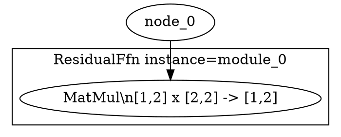

# VeriNeural
## Техническая спецификация архитектурно-независимого конструктора нейросетевых вычислений

**Тип проекта:** импортируемая Rust-библиотека, компилятор для NVIDIA GPU, минимальный CUDA runtime для запуска вычислений и система формальной верификации Lean 4.

**Назначение:** создание собственных нейросетевых архитектур, в том числе альтернативных Transformer для языкового моделирования, из математических операций, пользовательских алгоритмов и композиционных контрактов. VeriNeural предоставляет гибкий конструктор, а не готовую LLM или её инфраструктуру.

**Статус документа:** целевая спецификация без этапов/MVP. Реализованное подмножество и порядок разработки описаны в ROADMAP.md. Целевые требования ниже не означают, что всё уже реализовано.

### Границы продукта

- **Предмет разработки:** расширяемые вычислительные примитивы, Rust-контракты, вложенные блоки, параметризованные графы, Semantic Neural IR, компиляция в NVIDIA GPU, Lean-модели и композиционная проверка.
- **Уровни сборки:** операция → пользовательский блок → составной блок → полная архитектура. Модуль можно переиспользовать без копирования исходной математики на CUDA и Lean.
- **Не являются обязательными и не поставляются как готовая архитектура:** Transformer, стандартные Attention/MHA/GQA, KV Cache, специализированные MoE-роутеры, типовая LLM-инфраструктура, tokenizer, чат-сервис, serving API, распределённое обучение, оркестрация и деплой. Похожие функции автор вправе реализовать сам из универсальных примитивов.
- **Нужная исполняющая часть:** NVIDIA GPU compiler и минимальный runtime запуска/проверки GPU-кода. Отсутствие serving-инфраструктуры не означает отказ от CUDA Driver API.
- **Гарантии:** Lean доказывает только явно сформулированные свойства при их предпосылках. Корректность алгоритма не доказывает автоматически полезность, обучаемость, качество текста или производительность новой архитектуры.

## 1. Основные требования

Система должна обеспечивать:

1. Задание пользовательской математики и формальных контрактов на Rust в документированном поддерживаемом подмножестве.
2. Иерархическое построение параметризованных и переиспользуемых блоков, вложенных подграфов и произвольных поддерживаемых архитектур без LLM-шаблона.
3. Единый типизированный Semantic Neural IR, сохраняющий структуру композиции, зависимости, формы, параметры и контракты.
4. Генерацию из **одного IR** двух путей: LLVM NVPTX/PTX для NVIDIA GPU и Lean 4 моделей/теорем/обязательств доказательств.
5. Расширение вычислительного набора без ручного дублирования алгоритма на CUDA и Lean. Новый примитив должен иметь достаточную семантику и доказательства для запрашиваемого уровня гарантий.
6. Модульные доказательства и их композицию до уровня всей пользовательской архитектуры с собственными глобальными инвариантами.
7. Модели IEEE 754 binary32, точные численные доказательства или формально ограниченные погрешности при явных предпосылках.
8. Управление GPU-компиляцией: потоки, память, scheduling, fusion/tiling и FP32-политику с проверкой разрешённых преобразований.
9. Проверяемую привязку исходного IR, Lean-теорем, LLVM/PTX, параметров, профиля GPU и численно проверенных запусков к отчёту о TCB.
10. Отказ certified-build при неподдерживаемой операции, недоказанной обязательной цели или несовместимой композиции.

**Единый источник алгоритма и контракта — Rust-проект.** Это не обещание анализа произвольного Rust-кода: поддерживаемое подмножество и ограничения должны быть явными.

## 2. Общая архитектура

```text
                RUST SOURCE
          Modules + Math Contracts
                      │
                      ▼
               Rust Frontend
                      │
                      ▼
              Semantic Neural IR
                      │
           ┌──────────┴───────────┐
           │                      │
           ▼                      ▼
     GPU Compiler            Proof Compiler
           │                      │
     Fusion / Tiling         Lean 4 Models
     GPU Scheduling          Module Contracts
           │                 FP32 Semantics
           ▼                 Proof Obligations
         GPU IR                   │
           │                      ▼
           ▼                 Lean 4 Prover
        LLVM IR                   │
           │                      ▼
           ▼                 Proof Checker
       LLVM NVPTX                 │
           │                      │
           ▼                      │
          PTX                     │
           │                      │
           ▼                      │
    PTX Verification              │
           │                      │
           ▼                      │
     NVIDIA GPU                   │
           │                      │
           └──────────┬───────────┘
                      ▼
             Certificate Engine
                      │
                      ▼
     VERIFIED USER-DEFINED ARCHITECTURE
```

GPU Compiler и Proof Compiler используют один типизированный Semantic Neural IR с сохранёнными границами вложенных блоков, портами и доказательственными зависимостями.

Генерация LLVM IR и Lean 4 производится разными backend-компонентами, но пользовательские алгоритмы и контракты определяются только один раз. Lowering может разворачивать блоки для GPU, сохраняя проверяемое отображение на исходную иерархию.

## 3. Rust API и конструктор архитектур

Библиотека предоставляет архитектурно-независимый API для тензоров, вычислительных операций, параметров, явного состояния, контрактов и вложенной композиции. Обязательные требования к расширяемости операций, самостоятельным доказательствам пользовательских свойств и API без встроенных архитектурных монолитов уточнены в § 17.

Основные абстракции:

- `Tensor<T, Shape>` — тензор с проверенными размерами.
- `NeuralGraph` / `NodeId` — сборка вычислительного графа из поддерживаемых операций.
- `NeuralModule` — пользовательский или библиотечный блок с явным интерфейсом.
- `MathContract` — предусловия, постусловия и инварианты; при необходимости численные оценки.
- `FP32Policy` — требуемая численная семантика, не доказательство её соблюдения.
- **Целевое расширение конструктора:** параметризованные вложенные графы, иерархические области имён, повторно используемые блоки, экспортированные порты, состояния/переходы и пользовательские инварианты всей архитектуры.
- **Целевые типы результатов:** `Certified<T>` / `VerifiedKernel` только при наличии именно тех гарантий, которые они обещают. Ни численная проверка, ни успешная компиляция сами по себе не означают формальной сертификации GPU.

### 3.1. Пример пользовательской операции

Пример на действующем явном Rust DSL без шаблона Transformer:

```rust
use verineural::{NeuralError, NeuralGraph, NodeId};

fn custom_transition(
    graph: &mut NeuralGraph,
    state: NodeId,
    signal: NodeId,
    weights: NodeId,
) -> Result<NodeId, NeuralError> {
    let projected = graph.matmul(state, weights)?;
    let mixed = graph.add(projected, signal)?;
    graph.relu(mixed)
}
```

Реальные формы, домены и смысл `state` задаёт разработчик. Это **одно вычисление перехода**, а не уже реализованная рекуррентная машина или хранение долгосрочного состояния.

**Целевая иерархия:** такую функцию можно оформить модулем с `requires` / `ensures`, вложить много модулей в блок более высокого уровня и задать глобальный контракт архитектуры. Проверка крупного блока должна выводиться из проверенных свойств его частей, а не только из совпадения форм.

### 3.2. Пользовательская математика

- Поддерживаемые элементарные операции, включая линейную алгебру, редукции, индексацию и сравнения, образуют строительный материал, но не готовую LLM-архитектуру.
- Для новой операции явно задаются семантика, формы, домены, ограничения памяти, численная политика и обязательства доказательства. Разработчик не должен поддерживать три вручную синхронизируемые реализации алгоритма.
- Если расширение нельзя отобразить в поддерживаемые GPU IR и Lean-модель, оно получает статус `unsupported`. Это блокирует сертификацию, если соответствующая гарантия обязательна.
- Повторно используемые блоки должны иметь стабильную идентификацию и параметризацию для кеширования проверенных лемм и прослеживаемости отчёта.
- Динамические формы, ветвления, циклы, состояния и связи по времени имеют **явную семантику**. Подмножество без реализованной проверки не принимается под видом готовой сертифицированной функции.

### 3.3. Именованный frontend (реализованный узкий срез)

`ModelBuilder` предоставляет `input`, `parameter`, `block`, `output`, `proof_goal` и `finish`. `NeuralGraph::compose_inferred` выводит структурный контракт непосредственно из IR, проверяет границы и скрытые зависимости, атомарно фиксируя только корректные блоки. `Model::bind` проверяет полный набор именованных тензоров, формы и домены; `Model::plan` передаёт все выходы и явные цели в существующий `ArchitectureAutoCompiler`.

Это не отдельный IR, не новое GPU-исполнение и не Lean-доказательство без запуска checker. Роли input/parameter пока сохраняются в модели и snapshot metadata, а не как самостоятельные операции IR. Нет изменяемых состояний, общего рекуррентного runtime, встроенного обновления параметров и автоматического доказательства FP32/SASS.

### P2 rotating-matrices: минимальные операции и подготовка consumer (код; локальная приёмка ожидается)

В `Tensor<T>` доступны `from_vec`, `from_slice`, `zeros` с общей `Shape::new`-валидацией. Host f32 reference дополнен `sub/div/exp/reduce_max` и явным правосторонним `broadcast_to`. Rust graph вводит `reduce_max(input, axis)` и `broadcast_to(input, Shape)`; `sub/div/exp` десахарятся в типизированный `PointwiseSpec` AST, в котором сохраняются идентификатор, версия и математическое выражение. Это не готовый softmax, пользователь компонует его из узлов сам.

Shape validation, обязательный `DType::F32`, детерминированная row-major перестановка и canonical IR/DOT видимость покрываются Rust-кодом и тестами. `reduce_max` сохраняет первый максимум, при NaN выдаёт NaN; broadcast повторяет только singleton-оси. Произвольный NumPy-like implicit broadcasting для арифметики не разрешается. `PointwiseExpr::Sub/Div/Exp` **не имеют** модели ideal-Int в Lean: доказательный backend отклоняет их до генерации Lean. `ReduceMax/BroadcastTo` также Lean/GPU unsupported, как и новые pointwise операции на GPU. Никакого фиктивного сертификата/заявления FP32/IEEE equivalence нет. Эти ограничения должны быть сняты отдельным доказуемым вертикальным срезом.

Лаборатория перенесена на `Tensor::from_slice`; повторная публикация certified bundle, SHA-256 и Graphviz остаётся исключительно за Stage 10 (`Model::certify`), без локального `write_architecture_manifest`, ручного SHA/copy. Structural/index routing P0 имеет узкий GPU lowering; локальная сертификация всё ещё требует реального Lean/LLVM прогона и не означает IEEE-754/JIT/SASS доказательства.

### 3.5. P1 state transition и named CUDA Graph replay (API-срез; локальные проверки ожидаются)

`ModelBuilder::state` регистрирует источник с ролью State; `next_state` объявляет один чистый переход с проверкой формы, типа и домена. Эти связи входят в identity и являются самостоятельными IR roots. `block_multi` выводит структурные контракты именованных выходов атомарно, без неявных математических доказательств.

`GpuEngine::prepare_model` принимает полные initial bindings и компилирует общий CUDA Graph. `ModelExecution::set_input/set_parameter/set_state` обновляют только запрошенный буфер; `run` исполняет replay без изменения state; `step` после replay переносит `next_state → state` через явный `cuMemcpyDtoDAsync_v2` на non-blocking CUDA stream; `output` и `state` читают значения. Прежний `GpuExecution` сохранён.

**Аппаратная приёмка P1, реализация теста:** `task gpu-state-replay` запускает в том же CUDA Graph модель с двумя публичными выходами и скрытым feedback-результатом. Независимые точные FP32 fixtures сравнивают результаты `run()` и пяти последовательных `step()`, проверяют накопление state после D2D, повторное использование parameters, обновления по имени, reset и fail-closed для неверных source role/shape/domain. CUDA Graph создаётся только при `prepare_model`, а не между шагами. Задача не входит в обычный `task test`, требует CUDA/LLVM и должна быть подтверждена локальным запуском.

Граница гарантий: IR остаётся чистым DAG; temporal replay не является Lean-доказательством рекуррентного алгоритма, исполнения CUDA или FP32/SASS. Unsupported GPU operations отклоняются. Для rotating-matrices добавлен узкий GPU lowering профиль structural/indexing P0: rank-2 transpose, rank-2 reverse по axis 0/1, contiguous concat по axis 0, rank-2 last-axis `ArgMax(First)` и scalar `Take` по axis 0. Для этого профиля memory contracts теперь порождают проверяемые Lean-обязательства границ фактических row-major адресов; `Take` требует явную предпосылку `selected < choices`. Остальные формы fail-closed; deterministic runtime уже исполняет единый architecture graph без host route/rotation, а P1 переводит state feedback и named parameter/input updates этого пути на `ModelExecution`. Все объявленные state sources обязательно входят в GPU execution roots, даже если `next_state` игнорирует прежнее состояние. До первого replay проверяется layout D2D feedback; публичные выходы, делящие GPU allocation с state, получают повторно используемые device snapshots до обратной связи. Поэтому `output(name)` после `step` относится к чистому вычислению до обновления state, включая `Reshape`-алиасы. Несколько feedback-копий с опасными взаимными alias-перекрытиями по-прежнему отклоняются. При ошибке CUDA D2D-очереди, переноса output snapshots либо stream synchronization `GpuExecution` становится необратимо `ExecutionPoisoned`: любые последующие replay, чтение, rebinding и feedback отклоняются до создания нового execution. Предварительная ошибка проверки формы/домена/aliased layout **не** отравляет сессию. Это fail-closed поведение, а не транзакционный rollback уже поставленных DMA: частично обновлённые значения после ошибки нельзя считать достоверными. Отдельный CUDA fault-injection не заявлен проверенным: Rust-тесты имитируют результат transfer/sync через общий health gate.

**P1 session-wide CUDA lifecycle (код, приёмка ожидается):** `ExecutionHealth` дополнен `OutputNotReady` и общей проверкой ошибок H2D, D2D, D2H, `cuGraphLaunch`, stream sync и benchmark. После успешной валидации перед началом обновления входа или GPU replay выходы становятся неготовыми; только успешно завершённый `replay()` переводит их в готовое состояние. Ошибка CUDA IO/launch/sync необратимо переводит execution в `ExecutionPoisoned`. Ошибка проверки формы/домена без обращения к CUDA не инвалидирует предыдущий результат и не отравляет сессию. Важное ограничение: CPU fault-injection тестирует health state, не драйвер NVIDIA. `output(name)` до первого replay либо после изменения входа выдаёт `OutputNotReady`, не читает неинициализированную память.

**P2 индексирование `dependency_scope()` (код, приёмка ожидается):** временный индекс `output NodeId -> declared module inputs` строится один раз на обход; обход далее идёт по обычным DAG-рёбрам и индексированным декларациям. Для нескольких module invocations с одним output зависимости объединяются, не теряются. Добавлены тесты сравнения с прежним обходом и неиспользуемых портов.

**P2 append transactions:** `NeuralGraph` заменяет полное клонирование IR при `apply_module`, `compose_inferred`, `compose_multi_inferred`, `scan_fixed` и `apply_multi_module` на контрольные длины append-only коллекций `nodes/modules/multi_modules/module_order`; RAII rollback срабатывает при `Err` и при unwind. Вложенный успешный блок откатывается вместе с ошибочным внешним. Identity графа и правила захвата сохраняются. Это не обещание асимптотической скорости GPU: сокращаются Rust CPU allocations при композиции.

**Stage 10 (реализованный API-срез, без подтверждённой приёмки):** `Model::certify(CertifiedBuildConfig::new(package_root))` и `Model::verify_certified(config, pinned_sha256)` используют те же Lean/GPU/SHA256 backend'ы, что `ArchitectureAutoCompiler`. Все явно объявленные ProofGoal обязательны; все named outputs требуют поддерживаемого lowering. `identity.txt` внутри SHA256SUMS связывает модель, роли и цели, а `--artifact-root` в лабораторных примерах разрешается относительно package root. Появился Cargo external subcommand `cargo-verineural` (`build/verify --certified`, выбор package через `--manifest-path` и artifact root), который запускает единственный тонкий consumer `examples/<name>_certified.rs` (уникальное имя executable target в Cargo workspace); для использования как `cargo verineural` бинарник должен быть доступен в PATH, без установки доступна Taskfile-команда `task certified-build`. В корне выбранного package после сборки создаются относительные Unix symlink на опубликованный `auto-build/`: canonical IR, DOT, PNG, Lean, SHA256SUMS, report, identity. Существующие артефакты с проверенным id/version архивируются, чужие не заменяются. Первая миграция корневых файлов не полностью атомарна; Stage 10 нельзя считать завершённым до приёмки CLI и доказательного пути. Это не является формальным FP32/SASS proof.


## 4. Semantic Neural IR

Центральный компонент всей системы.

IR фиксирует арифметику, пользовательские блоки, иерархию композиций, контракты, параметры и их семантику. Из одного IR должны строиться и GPU-код, и Lean-модель.

### 4.1. Вычислительные средства

Целевой набор **универсальных**, расширяемых строительных операций:

- Поэлементная арифметика, линейная алгебра, преобразования форм и типов.
- Indexing, gather/scatter, slice и перестановки с проверяемыми условиями памяти.
- Редукции, агрегаты, сравнения, условные вычисления и маски.
- Пользовательские математические функции и нелинейные преобразования.
- Параметризованные подграфы, интерфейсы модулей и композиция функций.
- Явное состояние, многошаговые переходы и циклы для тех фрагментов, у которых определены семантика и правила проверки.
- При необходимости исследования: дифференцирование и обновления параметров как общие вычислительные преобразования, а не обязательный `Backward` специальной LLM.

Attention, KV Cache и другие известные архитектурные компоненты **не входят в обязательный каталог примитивов**. Пользователь вправе выразить подобный алгоритм через базовые операции, если те поддерживаются.

### 4.2. Метаданные каждой операции

Каждый узел IR содержит:

- Входные и выходные типы.
- Размерности тензоров.
- Математическое определение операции.
- Домен допустимых значений.
- FP32-семантику.
- Правила округления.
- Допустимую численную погрешность.
- Предусловия и постусловия.
- Идентификаторы проверенных теорем и ещё не разрешённых обязательств доказательства.
- Зависимости от других узлов, идентификаторы блоков и отображение входных/выходных портов.
- Параметры, состояние и условия применимости инвариантов, если заданы.
- Семантические требования к памяти, параллелизму и допустимым GPU-преобразованиям.

### 4.3. Математические модели

Каждая поддерживаемая операция должна иметь три связанных представления:

**Ideal Semantics**

Математическая операция над идеальными числовыми объектами, например действительными числами.

**FP32 Semantics**

Та же операция с определёнными IEEE 754 binary32-округлениями, порядком вычислений и обработкой специальных значений.

**GPU Semantics**

Семантика конкретной реализации GPU, включая FMA, редукции, память и выбранную последовательность инструкций.

Компилятор обязан явно проверять установленное соответствие между уровнями. При отсутствии формальной связи отчёт различает Lean-доказательство идеальной модели, численную проверку FP32-выхода и доверенную компиляцию; автоматически объявлять эти представления эквивалентными запрещено.

### 4.4. Канонический граф архитектуры в Graphviz DOT

VeriNeural обязан уметь строить из Semantic Neural IR **единый самодостаточный текстовый файл `architecture.dot`** в синтаксисе Graphviz DOT. Его назначение — дать человеку и ИИ-агенту полную картину собранной пользовательской нейросети в одном артефакте: какие экземпляры компонентов существуют, как они вложены, какие тензоры и параметры проходят между ними, какие размеры и контракты действуют на каждой границе, какие доказательства и GPU-преобразования относятся к конкретным узлам.

DOT является **проекцией единого Semantic Neural IR**, а не вторым источником истины. Архитектуру нельзя считать корректной только потому, что DOT успешно сгенерирован или визуализирован. Канонический файл обязан содержать fingerprint исходного IR и включаться в общий SHA-256 manifest, чтобы его можно было однозначно связать с доказательствами, LLVM/PTX и сертификатом.

#### Полнота и иерархия

Certified-экспорт должен описывать **весь построенный граф архитектуры**, а не только удобный или оптимизированный output slice:

- Все зарегистрированные входы, параметры, состояния, операции, составные блоки и архитектурные выходы.
- Все `ModuleInvocation` как отдельные **экземпляры** с устойчивым instance-id и полным instance path; повторное использование одного определения модуля должно быть видно как несколько разных экземпляров.
- Иерархию модулей через вложенные `subgraph cluster_*`; кластер не имеет права скрывать внутренние узлы. Иерархия нужна для читаемости, но все примитивные операции и связи остаются в том же `.dot`.
- Узлы, не достижимые от выбранных архитектурных outputs, если они присутствуют в Semantic Neural IR, не отбрасываются молча: они включаются и явно помечаются, например `vn_reachable_from_output="false"`.
- Явные state/control dependencies, циклические/переходные зависимости и ветви, если такие конструкции поддерживаются соответствующим IR-фрагментом.
- Никаких скрытых captured dependencies: связь, влияющая на вычисление или контракт модуля, должна быть видна как порт/ребро либо экспорт должен завершиться ошибкой.

#### Свойства узла

Каждый узел должен иметь стабильный `vn_id` и достаточно данных, чтобы по одному DOT-файлу восстановить его роль в архитектуре. Для применимых свойств требуется указывать как минимум:

- Тип сущности: architecture input, parameter, state, primitive operation, module boundary, architecture output или иной поддерживаемый вид.
- Имя/тип операции, definition-id и instance path составного блока.
- Идентификаторы входных/выходных портов и их порядок.
- Shape каждого входа и выхода, dtype, layout/индексацию и broadcast/reshape-семантику, если они существенны.
- Домен значений и математическое определение/краткую semantic signature операции.
- FP32 policy: rounding mode, FMA/contract policy, subnormal/FTZ policy, reduction order и обработку special values в той мере, в какой они заданы IR.
- Численный контракт: scale/диапазоны, `epsilon`, exactness либо иной поддерживаемый error contract.
- Предусловия, постусловия, инварианты и ссылки на относящиеся theorem/obligation identifiers.
- Статус гарантии для релевантных свойств: `proven`, `validated`, `trusted`, `unsupported`; неизвестное или неподдержанное свойство должно быть помечено явно, а не просто исчезать.
- Роль параметра/состояния, mutability/versioning и ограничения параметров, если это часть модели.
- GPU lowering metadata: выбранный kernel/lowering kind, fusion membership, launch/scheduling metadata, memory contract и другие свойства, которые реально зафиксированы в Semantic Neural IR или compilation evidence.
- Идентификаторы связанных артефактов/теорем, когда они нужны для перехода от архитектурной схемы к доказательству или lowering evidence.

Для читаемости разрешено использовать краткий `label` или HTML-table label, однако **полные данные не должны существовать только в визуальном label**. Канонические свойства следует дублировать структурированными DOT attributes с устойчивым префиксом `vn_*`, чтобы ИИ-агент или иной инструмент мог разбирать файл без рендеринга Graphviz.

#### Свойства рёбер

Каждое ребро должно явно описывать не только факт зависимости, но и её интерфейс:

- `vn_src_port` и `vn_dst_port`.
- Роль связи: `data`, `parameter`, `state`, `control` либо другой документированный вид.
- Shape/dtype передаваемого значения.
- Существенную трансформацию на границе: reshape/view, broadcast, indexing mapping, aliasing или state transition.
- Порядок/версию зависимости там, где от этого зависит семантика.
- Связанные numerical/memory constraints, если они относятся именно к этой границе.

Входы и выходы составного модуля должны быть визуально и структурно сопоставимы с его declared interface: по DOT должно быть возможно определить, какой внешний tensor подключён к какому порту каждого instance.

#### Метаданные всего графа

Корневой `digraph` должен содержать как минимум:

- Architecture id/version и версию формата DOT-экспорта.
- Версию/совместимость спецификации VeriNeural.
- Cryptographic fingerprint канонического Semantic Neural IR.
- Версию VeriNeural/toolchain metadata, если она входит в сертифицируемую сборку.
- Активный FP32/GPU profile.
- Идентификаторы глобальных proof obligations и итоговый assurance status, если они уже вычислены.
- Список/идентификаторы архитектурных входов и outputs.

Непроизводительные значения вроде текущего timestamp, случайных UUID или process-local адресов не должны попадать в канонический DOT, если из-за них одинаковый IR перестаёт давать одинаковый файл.

#### Детерминизм и пригодность для ИИ-анализа

Для одинакового Semantic Neural IR, одинаковой конфигурации экспорта и одинаковых proof/lowering metadata генератор обязан создавать **байтово детерминированный** `architecture.dot`:

- стабильные идентификаторы, instance paths и порядок атрибутов;
- стабильный порядок кластеров, узлов и рёбер;
- однозначное escaping строк;
- отсутствие зависимости от порядка hash-map, адресов памяти или process-global counters;
- явные значения `unknown`/`unsupported` вместо неоднозначного отсутствия критически важного свойства.

Файл должен оставаться удобным для чтения в сыром виде. Визуальные цвета, формы и стили разрешены как дополнительный слой, но семантика не должна кодироваться только цветом или геометрией.

Минимальный стиль канонического вывода может выглядеть так:



Это только пример формы сериализации. Реальный экспорт обязан отражать фактический Semantic Neural IR, а не жёстко заданный каталог архитектурных компонентов.

`architecture.png` является **обязательным производным артефактом** той же архитектуры и должен автоматически создаваться сразу после успешной записи `architecture.dot` через Graphviz из pinned devShell/toolchain:

```bash
dot -Tpng architecture.dot -o architecture.png
```

Порядок обязателен: сначала VeriNeural самостоятельно сериализует канонический DOT, затем Graphviz рендерит PNG **только из этого сохранённого DOT**. Ошибка `dot`, отсутствие Graphviz либо отсутствие/пустой `architecture.png` считаются ошибкой выпуска архитектурных артефактов в certified build. PNG не является источником семантики и не заменяет DOT или `architecture.lean`; он нужен как готовое визуальное представление для человека и визуальных инструментов. Дополнительные SVG/PDF могут выпускаться опционально.

Для одинакового `architecture.dot` и одной и той же pinned версии Graphviz рендер должен быть воспроизводимым; `architecture.png` включается в SHA-256 manifest вместе с DOT. Генерация самого `.dot` по-прежнему не зависит от Graphviz: зависимость Graphviz начинается только на обязательном шаге PNG-rendering.

## 5. Формальные контракты архитектурных компонентов

Каждый нейросетевой модуль определяется как функция с математическими предусловиями и постусловиями.

Контракт описывает:

- Допустимые входные значения.
- Размерности входов и выходов.
- Ограничения на параметры.
- Математические свойства результата.
- Инварианты модуля.
- Численные границы FP32-погрешностей.
- Условия взаимодействия с последующими модулями.

### 5.1. Composition Verification

При объединении модулей компилятор автоматически проверяет, что выходные гарантии одного модуля удовлетворяют входным требованиям следующего.

Формальная цель композиции:

```text
Module A:
    requires P
    ensures  Q

Module B:
    requires Q
    ensures  R

Composition B(A(x)):
    requires P
    ensures  R
```

Для численных модулей свойство `Q` включает не только математические условия, но и допустимые FP32-погрешности.

Если предыдущий блок гарантирует погрешность `ε₁`, а следующий допускает максимум `ε₂`, компилятор обязан доказать совместимость этих условий.

Если требуемое свойство не следует из доступных контрактов и лемм, композиция не сертифицируется.

### 5.2. Инварианты произвольных архитектур

Конструктор должен поддерживать проверяемые свойства **без предположения о типе архитектуры**:

- Размерности, совместимость портов, диапазоны индексов, корректность адресации и объёма памяти.
- Предусловия пользовательских операторов, гарантии их результатов и корректность их повторного использования в блоках.
- Границы значений, монотонность, знаковые и алгебраические инварианты, ограничения состояний.
- Композицию вложенных вычислительных графов и передачу гарантий между блоками.
- Для повторяющихся вычислений: инвариант начального состояния, корректность одного перехода и индуктивное сохранение инварианта для всех разрешённых шагов.
- Для ветвлений или дискретных решений: условия стабильности выбора, корректность условий и согласованность путей.
- Для полной архитектуры: **пользовательские глобальные свойства**, формально сформулированные относительно её входов, выходов, параметров, состояния и конфигурации.

Ни наличие `NeuralModule`, ни успешная проверка форм не равнозначны доказательству функциональной корректности. Система должна явно перечислять доказанные цели, гипотезы и неподдерживаемые требования.

### 5.3. Иерархическая композиция и повторное использование доказательств

1. Пользователь описывает элементарный оператор с математической семантикой и контрактом.
2. Собирает **локальный блок** из операторов, формулирует инварианты и экспортируемый интерфейс.
3. Собирает **крупный блок** из экземпляров локальных блоков с конкретными параметрами и связями.
4. Собирает **полную пользовательскую архитектуру** и формулирует итоговые свойства.
5. Lean проверяет локальные свойства, условия применимости и теоремы композиции. Доказательства экземпляров можно переиспользовать лишь при подтверждённых предпосылках и совпадении семантики/параметров.

Иерархия сохраняется для proof/debug/reporting даже при разворачивании или fusion GPU-графа. Композиционный сертификат должен связывать теоремы об отдельных блоках с теоремой об архитектуре, а не представлять список локальных доказательств как доказательство всей системы.

## 6. FP32 Verification Engine

**FP32-верификация является обязательной частью архитектурной верификации, а не самостоятельной необязательной проверкой.**

### 6.1. Формальная арифметика

Lean 4 должен иметь формальную модель IEEE 754 binary32, используемую для доказательства свойств поддерживаемых операций.

Модель обязана учитывать:

- Округление Round-to-Nearest, Ties-to-Even и другие разрешённые режимы.
- FMA и отдельные Multiply/Add.
- Subnormal Values и Flush-to-Zero.
- NaN и Infinity.
- Signed Zero.
- Порядок выполнения операций.
- Ошибки накопления при редукциях.
- Погрешности математических функций, включая `exp`, `sqrt`, `tanh` и функции активации.

### 6.2. Два класса численных гарантий

**Exact FP32**

Доказательство соответствия битовой FP32-модели, включая определённые правила округления и специальные значения.

**Bounded Numerical Error**

Доказательство ограниченной погрешности относительно идеальной математической модели:

```text
For all x in ValidDomain:

    error(FP32(x), Ideal(x)) <= epsilon
```

Для сравнения с действительными числами должны быть определены условия конечности значений и корректная метрика ошибки. Неопределённые случаи, NaN и Infinity обрабатываются отдельными контрактами.

Система может использовать доказанную интервальную арифметику, оценку ошибок округления и специальные леммы для нелинейных функций.

### 6.3. Распространение погрешностей

Численная погрешность распространяется через **произвольно определённый граф** и его вложенные блоки. Иллюстрация без привязки к Transformer:

```text
Input + Parameters
       │
       ▼
Custom Block A     error ≤ ε₁
       │
       ▼
Custom Block B     error ≤ ε₂
       │
       ├──────────────┐
       ▼              ▼
Custom Branch C   State Transition D
       └──────┬───────┘
              ▼
        Architecture Output
        proven bound ε_total
```

Итоговая оценка определяется свойствами конкретных операций (чувствительностью к входным ошибкам, формой композиции, параметрами, нелинейностями). Она не обязана равняться простой сумме ε.

Для пользовательских ветвлений, маршрутизации и сравнений малое численное отклонение может изменить выбор пути. Для доказательства эквивалентности дискретного решения требуется достаточный зазор между сравниваемыми значениями, проверка граничных условий или явная процедура точного разрешения неоднозначности.

## 7. GPU Compiler

GPU Compiler переводит **любую поддерживаемую пользовательскую композицию** Semantic Neural IR в низкоуровневое GPU IR, затем в LLVM IR и PTX. Он не должен зависеть от фиксированного набора LLM-слоёв.

Обязательные функции:

- Operator Fusion.
- Kernel Fusion.
- Matrix Tiling.
- Thread Scheduling.
- Warp-Level Operations.
- Shared Memory Management.
- Memory Coalescing.
- Reduction Scheduling.
- **CUDA Graph execution:** построение графа GPU-работы из Semantic Neural IR, выделение допустимых зависимостей, инстанцирование и запуск через CUDA Graph API, а не последовательные независимые kernel launches.
- **Kernel Fusion:** контролируемое объединение совместимых вычислений с учётом повторных потребителей и семантических ограничений.
- **No CUDA Legacy Streams:** запрещены legacy/default/null streams, их неявная синхронизация и обход CUDA Graph через прямой запуск kernels; только явно выделенный non-blocking CUDA stream для graph capture/launch и передач данных.
- GPU Kernel Launch (внутри CUDA Graph).
- Явно управляемый профиль генерации: layout, размерность сетки, распределение работы, допустимые преобразования, варианты kernel и выбор ресурсов в рамках проверяемого подмножества.
- Memory Safety Verification.
- Race Freedom Verification.
- Synchronization Verification.

Цель — высокий контроль и эффективность на NVIDIA GPU без жёстко заданных алгоритмических шаблонов. Предусмотрены инспекция LLVM IR/PTX, возможность выбора/ограничения оптимизаций и сообщения о фактически применённых преобразованиях. Эффективность должна оцениваться измерениями, а не предполагаться из названия backend'а.

Оптимизации не могут свободно изменять FP32-семантику.

Каждое преобразование должно иметь проверенное правило корректности, учитывающее точность арифметики.

Если Fusion заменяет отдельные `mul` и `add` на FMA, система обязана учитывать изменение округления и доказать соответствие численному контракту.

### 7.0. Правила CUDA Graph и stream policy

1. CUDA вычислительный граф строится из достижимых узлов Semantic Neural IR. Зависимости между nodes должны сохранять результаты оригинального графа после допустимых слияний и иных преобразований.
2. `CU_STREAM_LEGACY`, `stream = 0` и любые эквивалентные default/null-stream пути **запрещены**. Для capture, `cuGraphLaunch`, host↔device transfers и ожидания используется явно созданный `CU_STREAM_NON_BLOCKING`, без неявного legacy fallback.
3. Внутри обычного пути инференса нельзя исполнять отдельные kernels вне CUDA Graph. Прямой `cuLaunchKernel` допускается **только во время stream capture**, где он формирует kernel-node графа; альтернативой является `cuGraphAddKernelNode`.
4. Память и потоковые зависимости должны иметь корректную область жизни для всего CUDA Graph. Буферы передачи с асинхронной операцией не освобождаются до её завершения; CPU/GPU конкуренция за данные запрещена.
5. Fusion — центральная стратегия сокращения числа GPU kernels и промежуточных аллокаций, а не обход математических проверок. Недоказанная FP32-эквивалентность не становится `proven` благодаря использованию CUDA Graph.
6. Если CUDA Graph API не поддерживается, соответствующий запуск отклоняется; совместимого обхода через legacy streams не существует.
7. Производительность проверяется на устройстве, отдельно различаются накладные расходы инстанцирования графа, replay и фактическое kernel execution.

### 7.1. Проверка результатов lowering

Система должна проверять соответствие:

```text
Semantic Neural IR
        ↕
    Verified GPU IR
        ↕
      LLVM IR
        ↕
        PTX
```

Для этого необходимы формальные семантики поддерживаемого подмножества инструкций, механизмы translation validation и доказательства сохранения наблюдаемого поведения.

Операции вне проверяемого подмножества отклоняются в сертифицированной сборке.

### 7.2. Граница доверия

Формальная проверка PTX не является автоматическим доказательством поведения произвольного физического GPU.

Если корректность последующей компиляции PTX в машинный код и исполнения аппаратурой не доказана, драйвер, JIT, устройство и соответствующие правила исполнения должны быть указаны как доверенные предположения.

Система не имеет права представлять условную гарантию как безусловное доказательство корректности аппаратного исполнения.

## 8. Lean 4 Proof Engine

Proof Engine генерирует формальные модели и доказательства по структуре Semantic Neural IR.

### Типы доказательств

**Module Correctness**

Соответствие реализации математической спецификации.

**Composition Correctness**

Корректность взаимодействия отдельных архитектурных блоков.

**Numerical Correctness**

FP32-эквивалентность или математически доказанные границы погрешности.

**Optimization Correctness**

Корректность Fusion, Tiling и остальных преобразований компилятора.

**Memory Correctness**

Отсутствие недопустимых обращений к памяти, гонок и нарушений заданной модели синхронизации.

**Network Correctness**

Корректность композиции всех компонентов нейросети при заданных предусловиях.

### Механизм доказательств

Предусматривается библиотека проверенных лемм для тензоров, численной арифметики, маршрутизации и композиции.

Proof Engine автоматически создаёт задачи доказательства, применяет подходящие леммы и тактики и передаёт результаты проверяющему ядру Lean.

Новая пользовательская математика может создавать дополнительные обязательства доказательства. Если автоматическая система их не разрешает, разработчик должен уточнить контракт или предоставить вспомогательные леммы в Rust-ориентированном интерфейсе спецификаций.

Ручное создание отдельной реализации алгоритма на Lean не требуется.

Использование `sorry`, непроверенных аксиом или непрозрачных доверенных вычислений без соответствующего разрешения политикой сертификации запрещается.

## 9. Верификация целой пользовательской архитектуры

Итоговый объект VeriNeural — **произвольная архитектура, собранная разработчиком** из универсальных примитивов и вложенных блоков. Языковая модель, если она создаётся поверх библиотеки, является *потребителем*, а не встроенной реализацией Transformer или сервиса инференса.

Цели проверки полной архитектуры:

- Типовая и размерностная корректность всех соединений, параметров и состояний.
- Корректность контрактов отдельных операций и их включение в контракт каждого составного блока.
- Выполнение предпосылок повторно используемых лемм и доказательств.
- Глобальные функциональные свойства архитектуры, если они заданы разработчиком: отношения входов и выходов, ограничения состояния, инварианты переходов и условий ветвления.
- Численные гарантии композиции, включая FP32-поведение и распространение ошибки в пределах объявленных доменов.
- Применимость доказательств к реально использованным параметрам, GPU-профилю, оптимизациям и конкретным запускам.

**Что именно доказывает Lean:** каждое проверенное утверждение относится к указанной модели и предпосылкам. Поузловое равенство определению в Lean или проверки интерфейсов недостаточно, чтобы автоматически заключить корректность всей архитектуры. Для глобального `proven` требуется отдельная проверенная теорема композиции об этом глобальном свойстве.

Если исследователь включает обучение, изменение параметров или пользовательское состояние, их семантика и контракты проверяются аналогично прочим вычислениям. Готовый generic Backward/optimizer **не обязателен** для завершённости самого конструктора: необходим путь для определения и проверки пользовательских обновлений в поддерживаемом подмножестве.

**Не следует из доказательств:** качество генерации, соответствие задаче, интеллект системы, способность к обобщению, сходимость оптимизации и достаточная производительность. Для этих заявлений нужны отдельные спецификации, измерения и доказательства.

## 10. Сертификация параметров и исполнения

Для итоговой нейросети сертификат должен учитывать:

- Версию архитектуры.
- Конфигурацию модулей.
- Значения или проверенные ограничения параметров.
- Размерности и динамические диапазоны форм.
- FP32-профиль.
- GPU-архитектуру.
- Версии используемых инструментов.
- Формальные предположения.

При загрузке весов система проверяет соответствие параметров условиям применимости доказательств.

Если доказательство опирается на конкретные веса, их изменение требует новой сертификации. Если доказательство универсально по всем весам, удовлетворяющим контракту, достаточно проверить этот контракт.

Для отдельного запуска система должна различать:

- Универсальную теорему о вычислениях.
- Проверку принадлежности конкретного входа допустимому домену.
- Сертификацию конкретного результата.

При необходимости допускается повторная проверка результата или специализированный проверяемый вычислительный сертификат.

## 11. Логические компоненты и организация проекта

Целевые **ответственности**, а не предписание создать отдельный crate на каждое название:

- **Rust API / Frontend:** создание пользовательских операций, параметризованных блоков и контрактов.
- **Typed Semantic Neural IR:** типы, формы, семантика, зависимости, интерфейсы и иерархия модулей, явное состояние.
- **Proof Backend:** Lean-модели, задачи доказательства, проверенные леммы и композиционные теоремы.
- **GPU Backend:** контролируемые layout/scheduling/оптимизации, LLVM NVPTX/PTX, проверки lowering.
- **CUDA Runtime:** минимальный запуск и проверка вычислений на NVIDIA GPU, без serving/деплоя/серверов.
- **Certificate Engine:** связность артефактов, доказательные зависимости, границы TCB и статусы гарантий.
- **Примеры и тесты:** пользовательские математические операторы, вложенные композиции, состояние и архитектурно-нейтральные графы, а не готовая LLM.

Реальная Rust-библиотека размещается в `crates/verineural/` внутри Cargo workspace; отдельные crates создаются лишь по фактической необходимости и правилам `AGENTS.md`. Целевая разбивка Lean-файлов определяется реализованными математическими и компиляционными доказательствами.

## 12. Сборка пользовательской архитектуры

### 12.1. Лаборатории пользовательских архитектур

Рекомендуемая организация нескольких независимых экспериментов в одном репозитории:

```text
labs/
├── atlas-cell-0.1.0/
│   ├── Cargo.toml
│   ├── src/
│   │   └── lib.rs
│   ├── semantic.ir
│   ├── architecture.dot
│   ├── architecture.png
│   ├── architecture.lean
│   ├── gpu/
│   ├── verification/
│   ├── certificates/
│   ├── reports/
│   └── SHA256SUMS
└── recurrent-field-0.3.0/
    ├── Cargo.toml
    ├── src/
    │   └── lib.rs
    └── ...
```

Каждая директория `labs/<architecture-name>-<version>/` является отдельным Rust consumer-проектом, который использует `verineural` как библиотеку и имеет собственную идентичность архитектуры, параметры, Semantic Neural IR и bundle артефактов. Переиспользуемая реализация конструктора остаётся в `crates/verineural/`; код конкретной исследовательской нейросети не переносится в библиотечный crate только ради сборки.

Имя каталога является удобной конвенцией, а не единственным источником истины. Architecture id/version должны также фиксироваться в сертифицируемых metadata; по умолчанию они могут выводиться из Cargo package name/version. Две лаборатории не должны делить неявный глобальный каталог артефактов.

### 12.2. Artifact root и выбор лаборатории

**Целевой**, ещё не реализованный полностью интерфейс должен поддерживать как минимум:

```bash
# Запуск из корня конкретной лаборатории: артефакты появляются здесь же.
cargo verineural build --certified

# Выбор лаборатории из корня workspace.
cargo verineural build --certified \
  --manifest-path labs/atlas-cell-0.1.0/Cargo.toml

# Явное переопределение каталога артефактов.
cargo verineural build --certified \
  --manifest-path labs/atlas-cell-0.1.0/Cargo.toml \
  --artifact-root /mnt/experiments/atlas-cell-run
```

Правила разрешения пути:

- **По умолчанию artifact root равен корню Cargo package пользовательской архитектуры**, то есть директории, содержащей её `Cargo.toml`. Для стандартной структуры `labs/<name>-<version>/` ключевые артефакты тем самым появляются прямо в корне лаборатории.
- `--artifact-root <path>` переопределяет этот каталог для всех backend'ов и certificate/evidence writers одной сборки. Внутренние подсистемы не имеют права самостоятельно возвращаться к repository root, общему `target/verineural/` или иному скрытому output path.
- Относительный `--artifact-root` разрешается относительно корня package выбранной архитектуры, **не** относительно process current working directory. Абсолютный путь допустим.
- Rust API certified-build должен иметь эквивалентную явную настройку artifact root; CLI и API используют одну реализацию разрешения путей.
- Физический абсолютный путь вывода является packaging/runtime detail и не входит в Semantic Neural IR, theorem statements, канонический DOT или semantic fingerprints. Перемещение неизменной лаборатории в другой каталог не должно менять её доказательную семантику и канонические хеши содержимого.
- Все генерируемые пути обязаны оставаться внутри выбранного artifact root, кроме явно названных внешних входов. Нельзя незаметно писать часть bundle в общий repository-level каталог.
- Certified build не должен молча перезаписывать bundle другой architecture id/version. Если выбранный artifact root уже содержит несовместимый manifest/identity, сборка завершается ошибкой либо требует отдельного явного режима очистки/замены.

### 12.3. Процесс сборки

Обязательный процесс:

1. Принять из Rust конструктора пользовательские операторы, составные модули, параметры и глобальные свойства.
2. Построить единый Semantic Neural IR с иерархией блоков и идентичностью их экземпляров.
3. Проверить формы, домены, состояние и совместимость локальных контрактов.
4. Сгенерировать Ideal/FP32/GPU-семантики в поддерживаемом подмножестве.
5. Сгенерировать и проверить Lean-доказательства для примитивов, блоков, связей и **глобальных требований архитектуры**.
6. Применить разрешённые контролируемые GPU-преобразования и получить LLVM IR/PTX.
7. Проверить необходимые инварианты памяти, GPU-lowering и численную семантику, если они входят в запрошенный уровень.
8. Проверить актуальность параметров, GPU-профиля и предпосылок входных доменов.
9. Из финального аннотированного Semantic Neural IR и связанных proof/lowering metadata детерминированно выпустить полный `architecture.dot`; его `vn_ir_sha256` должен соответствовать каноническому IR этой же сборки.
10. Автоматически отрендерить из сохранённого `architecture.dot` файл `architecture.png` через pinned Graphviz; выпуск архитектурных артефактов считается успешным только при наличии согласованной тройки `architecture.dot`, `architecture.lean` и `architecture.png`.
11. Проверить, что все файлы текущего bundle находятся под единым разрешённым artifact root, принадлежат выбранной architecture id/version и не конфликтуют с bundle другой лаборатории.
12. Выпустить исполняемые файлы и отчёт с уровнями `proven`, `validated`, `trusted`, `unsupported`.

Любое недоказанное **обязательное** свойство останавливает сертифицированную сборку. Отдельный диагностический запуск допустим, но не объявляется формальным сертификатом.

## 13. Выходные артефакты

**Пример целевой схемы** при стандартном lab-scoped artifact root:

```text
labs/<architecture-name>-<version>/
├── Cargo.toml
├── src/
│   └── lib.rs
├── semantic.ir
├── architecture.dot
├── architecture.png
├── architecture.lean
├── gpu/
│   ├── program.ll
│   └── program.ptx
├── verification/
│   ├── primitives.lean
│   ├── blocks.lean
│   ├── numerical.lean
│   └── lowering.lean
├── certificates/
│   └── architecture.json
├── reports/
│   ├── obligations.json
│   ├── numerical.json
│   └── trusted_base.json
└── SHA256SUMS
```

При кастомном `--artifact-root` та же внутренняя структура артефактов переносится целиком в выбранный каталог; Rust source package при этом остаётся в своей лаборатории и не копируется автоматически.

Это целевая организация, **не утверждение**, что все файлы уже создаются. Файл доказательства или статус `proven` может появляться только при реальной проверке соответствующей цели.

Отчёт должен связывать: исходный IR, `architecture.dot`, пользовательские операции и вложенные блоки, теоремы и гипотезы, входы, значения параметров либо их ограничения, численную политику, профиль NVIDIA GPU, версии инструментов, LLVM/PTX, результаты исполнения, TCB и хеши артефактов.

`architecture.dot` является обязательным человеко- и машиночитаемым индексом архитектуры, но не заменяет `semantic.ir`, Lean evidence или сертификат. Certified build должен проверять, что указанный в DOT fingerprint IR совпадает с каноническим IR текущего bundle. `architecture.png` автоматически рендерится pinned Graphviz из этого же сохранённого DOT, включается в SHA-256 manifest и служит визуальным представлением; он не является отдельным источником семантики или доказательства. `architecture.lean` остаётся формальным архитектурным артефактом той же сборки. Дополнительные SVG/PDF могут быть опциональными.

SHA-256 обеспечивает контроль целостности относительно доверенного манифеста, а не авторство. JSON, DOT или PNG не подменяют Lean-доказательство и не подтверждают корректность машинного кода сами по себе.

## 14. Обязательные условия приёмки

VeriNeural считается **готовым архитектурно-нейтральным конструктором**, когда выполнено каждое условие (включая отдельные критерии API и proof soundness из § 17.5):

1. Пользователь на Rust задаёт **собственную математическую операцию** и строит из неё несколько параметризованных, повторно используемых блоков без предписанной архитектуры LLM.
2. Блоки вкладываются друг в друга и образуют крупную пользовательскую архитектуру с явными портами, параметрами, при необходимости состоянием и глобальными контрактами.
3. Из **одного Semantic Neural IR** автоматически генерируются исполняемая NVIDIA GPU-программа и Lean 4-модели без ручного переписывания одной логики на CUDA/Lean.
4. Lean проверяет содержательные локальные математические свойства блоков, а не только формы и поузловые равенства собственным определениям.
5. Для заявленного глобального свойства архитектуры есть отдельная проверенная **композиционная теорема**, связывающая локальные леммы, интерфейсы, параметры, инварианты и предпосылки.
6. Для поддерживаемого FP32-фрагмента формально доказаны заявленные точные свойства либо ограниченная численная ошибка, распространяющаяся по композиции.
7. Поддерживаемые GPU-lowering и оптимизации имеют проверенные свидетельства сохранения нужной семантики. Оставшиеся границы доверия честно перечислены в TCB.
8. Параметры, домены входов, конфигурация архитектуры, профиль GPU, инструменты, IR/Lean/LLVM/PTX и доказательства привязаны проверяемыми артефактами.
9. Из того же Semantic Neural IR детерминированно генерируется один полный `architecture.dot`, содержащий иерархию модулей, все экземпляры и связи, формы/типы/порты, параметры/состояние, численные и proof/GPU metadata; он связан fingerprint'ом с каноническим IR и пригоден для анализа без внешних файлов.
10. Из `architecture.dot` автоматически создаётся `architecture.png` pinned Graphviz-рендером; DOT, PNG и `architecture.lean` выпускаются вместе, PNG входит в manifest и никогда не считается самостоятельным доказательством.
11. Несколько лабораторий могут независимо сосуществовать в одном workspace: каждая имеет собственный artifact root, а certified build не пишет архитектурные артефакты в общий repository-level каталог и не перезаписывает bundle другой architecture id/version без явного действия пользователя.
12. Certified-build отклоняет неподдерживаемые операции и недоказанные обязательные свойства; численная валидация не выдаётся за доказательство.
13. End-to-end собственная архитектура собирается и исполняется на NVIDIA GPU с независимой проверкой результата **без обязательных Transformer, KV Cache или serving-инфраструктуры**.

**Не являются критериями завершения:** готовые Transformer/Attention/MoE/KV Cache, типовая LLM, inference API, чат-система, сервер/деплой, распределённый тренинг, доказанное качество или скорость генерации текста.

## 15. Основные архитектурные принципы

**Architecture Neutrality**

Конструктор не навязывает Transformer либо любую другую модель. Поддержка ограничивается явными вычислительными примитивами, состояниями, композициями и формально описанной семантикой.

**Hierarchical Composition**

Составные блоки имеют проверяемые интерфейсы, параметризацию и связи. Корректность всей архитектуры требует доказательства отдельного глобального утверждения, а не простой агрегации локальных успехов.

**Single Source of Truth**

Алгоритмы, архитектурные компоненты и контракты определяются в едином Rust-проекте.

**Semantics First**

Промежуточное представление фиксирует математическую и численную семантику до GPU-оптимизаций.

**Proof-Carrying Compilation**

Оптимизации сопровождаются проверяемыми свидетельствами сохранения заданных свойств.

**Numerical-Aware Composition**

Архитектурные теоремы учитывают реальную численную точность и ограничения операций.

**Fail-Closed Certification**

Если обязательное доказательство отсутствует, итоговый сертификат не создаётся.

**Explicit Trust Boundary**

Система не скрывает непроверенные предположения о компиляторе, драйвере или GPU.

**Reusable Proofs**

Один раз доказанные математические примитивы и правила композиции повторно используются для новых архитектур.

**Inspectable Architecture**

Полная собранная архитектура должна иметь детерминированное самодостаточное DOT-представление, в котором явно видны hierarchy, instance identity, shapes, ports, зависимости, контракты и статусы доказательств/lowering. Визуальная схема является проверяемо связанной проекцией Semantic Neural IR, а не параллельной моделью.

---

## 16. Конечная цель

**VeriNeural — конструктор проверяемых вычислительных архитектур для NVIDIA GPU.** Его назначение — дать исследователю инструменты для реализации собственных алгоритмов, включая альтернативные Transformer способы построения языковых моделей, без поставки предзаданной LLM.

Разработчик на Rust:

1. Определяет математические операции и их ограничения.
2. Объединяет операции в повторно используемые малые и крупные блоки.
3. Строит из блоков архитектуру со своей логикой передачи данных, параметрами и, если требуется, состоянием.
4. Формулирует локальные контракты и отдельные глобальные утверждения об архитектуре.

VeriNeural для **поддерживаемой** семантики:

1. Создаёт единый типизированный Semantic Neural IR.
2. Генерирует из него детерминированный полный `architecture.dot`, пригодный для чтения человеком и ИИ-агентом и связанный fingerprint'ом с IR, и автоматически рендерит рядом `architecture.png` через pinned Graphviz.
3. Компилирует управляемый NVIDIA GPU-код через LLVM NVPTX → PTX.
4. Генерирует Lean 4-модели и проверяемые теоремы о примитивах и блоках.
5. Проверяет условия композиции и заявленные глобальные свойства архитектуры.
6. Доказывает доступные численные гарантии FP32 и условия применимости.
7. Проверяет допустимые оптимизации и связи между IR/LLVM/PTX в покрытом доказательствами подмножестве.
8. Выпускает проверяемый отчёт со статусами, предпосылками и TCB, **не называя неподтверждённое доказанным**.

**Результат:** одна точка разработки математической логики на Rust, масштабируемая модульная композиция и две согласованные целевые ветви компиляции, NVIDIA GPU и Lean 4. Система подтверждает определённые свойства вычислений и архитектуры, но не обещает автоматически доказать работоспособность любой новой математики, интеллект модели или безусловную корректность железа.

## 17. Ревью API: обязательные патчи для расширяемого конструктора и проверяемой композиции

Этот раздел фиксирует **нормативные требования к доработкам**, а не утверждает, что перечисленные возможности уже реализованы. Приоритеты основаны на анализе публичных Rust-интерфейсов `NeuralGraph`, `Operation`, `NeuralModule`, `MathContract`, `LeanProofEngine`, `RneRangePlan`, `GpuEngine`, `CertificateEngine` и их реализаций в `crates/verineural/src/`. Выполненный верифицированный срез и целевые возможности следует различать по фактическому коду, тестам и evidence.

### 17.1. Непересматриваемые границы API

1. **Библиотека предоставляет строительные средства, не архитектуры.** Публичное ядро обязано содержать выразительные математические примитивы, tensor/state/control IR, интерфейсы модулей, объявления контрактов, доказательные правила, GPU lowering и инструменты сертификации. Готовые архитектурные блоки уровня Transformer, Attention, FFN/Residual stack, RNN/LSTM/GRU, MoE, KV Cache и LLM не являются частью обязательного основного API; их собирает потребитель. Уже существующие демонстрационные `Dense`, `ResidualAdd` и `ResidualFfn` необходимо рассматривать как примеры композиций, не как границу расширяемости или обязательные элементы ядра. При изменении экспортов предусмотреть понятную миграцию существующих клиентов.
2. **Расширение не сводится к добавлению вариантов в закрытый `Operation`.** Автор архитектуры должен определять поддерживаемую пользовательскую операцию с одной версионируемой семантической декларацией, типизированными портами, контрактом и proof obligations. Нельзя принимать произвольную Rust-функцию за автоматически формализованную: поддерживаемый DSL/IR-фрагмент должен быть явно ограничен.
3. **Произвольные поддерживаемые композиции, включая языковые и рекуррентные архитектуры, являются потребителями одного механизма.** Нельзя добавлять архитектурные исключения в IR/proof/GPU backends ради конкретной лаборатории.
4. **Сертифицируются сформулированные свойства, не название компонента.** Результат проверки должен содержать отдельно математическую теорему, условия её применимости, доказательство композиции, численный контракт и подтверждённую либо доверенную связь с исполняемым GPU-кодом. Недоказанные обязательные условия блокируют выпуск выбранного уровня сертификата.
5. **Прагматичный объём.** Расширения вводятся рабочими вертикальными срезами: публичный Rust API → единый IR → Lean obligation/theorem → GPU lowering или явный `unsupported` → проверяемый отчёт. Не создавать самостоятельный фреймворк/каталог шаблонов/инфраструктуру до появления соответствующего реального потребителя.

### 17.2. Подтверждённые анализом кода ограничения исходного среза

- `ir.rs` / `primitive.rs`: реализован начальный P02-slice: `Operation::Pointwise(PointwiseSpec)` хранит **одну атомарную пользовательскую операцию** с декларативной `PointwiseExpr` (`input/add/mul/relu`), проверкой arity/shape, идентификатором, версией и телом в canonical IR. Lean-модель строится из AST; нет runtime Rust callbacks и непроверенной вставки Lean. При финальном `relu` доступно независимое идеальное доказательство `Nonnegative`, а остальные случаи без правила fail-closed. GPU lowering и строгая FP32-композиция для пользовательского примитива пока `unsupported`. `PrimitiveSpec` по-прежнему строит композицию обычных операций; это отдельный, не заменённый API. Полный P02 (общие dtype, reductions/indexing, backend extensibility, произвольная семантика) **не завершён**. `MathContract` поддерживает именованные `requires`/`ensures` и ограниченный набор `ContractClaim` (`Nonnegative`, `EqualsInput`); произвольных пользовательских предикатов, количественных ограничений и общего языка proof obligations пока нет.
- `ir.rs`: граница модулей теперь транзакционна, проверяет скрытые capture-зависимости и хранит полный полуоткрытый диапазон тела `[body_start, body_end)`. Есть именованные multi-output ports и единый application-order view для single/multi instances. При этом single- и multi-output декларации всё ещё представлены разными публичными contract/module типами, а общий predicate/effect/state interface ещё не сформирован.
- `ir.rs` / `tensor.rs`: формы в основном конкретны (`Vec<usize>`), graph dtype теперь имеет минимальное различение `F32`/`Index`, но layout и общий dtype-каталог остаются узкими. Есть bounded `scan_fixed` и многовыходные модули, но нет общей семантики изменяемого `State`/`Transition`, symbolic axis/index algebra и полноценного `step/scan` с индуктивными инвариантами.
- `ir.rs` / `proof.rs` (начальный relational slice): `Predicate` и типизированные `ValueRef` задают проверяемые `Nonnegative`, `Equal` и `PointwiseLe` для module contracts и architecture goals. Для `PointwiseLe` добавлена независимая Lean-лемма `pointwise_le_relu` над идеальными `Int`; настоящая Lean-проверка и аудит аксиом остаются обязательными. Ложное обратное отношение (`ReLU(x) ≤ x`) и ошибочные graph-local ссылки должны отвергаться. Это **не** полный пользовательский predicate DSL, не доказательство произвольной формулы, не численный FP32 bound и не доказательство CUDA lowering. При нехватке доказательного правила certified-сборка fail-closed. Positive/negative kernel acceptance выполняется командой `task verify-relational-predicates`.
- `proof.rs`: `node_*_semantics` по-прежнему доказывается через `rfl` относительно сгенерированного определения. Для `ContractClaim` и архитектурных целей уже генерируются отдельные содержательные обязательства, однако публичный `ProofGoalKind` остаётся ограниченным неотрицательностью и равенством; произвольного реестра пользовательских свойств нет.
- `numeric.rs`: `ExactFp32Plan`, `RneFp32Plan` и `RneRangePlan` реализуют содержательный, но ограниченный фрагмент exact-Int/dyadic-RNE и композиции. Его нельзя обобщать на любые функции, ветвления, длины рекурренции, значения FP32 и реальные CUDA kernels без дополнительных теорем и предпосылок.
- `gpu.rs` / `proof.rs`: `Sqrt` доступен через Rust `NeuralGraph` и host reference, но текущие ветви GPU/Lean не покрывают его как сертифицируемый end-to-end оператор; прочие операторы также проверяются только в перечисленном подмножестве. `certificate.rs` выпускает отчёт о конкретной проверке и SHA-256 evidence, не универсальный объект сертификата произвольного контракта.
- `architecture.rs`: snapshot и auto-DOT используют одну нормализованную иерархию module instances и один `NeuralGraph::canonical_ir()` fingerprint вместо параллельных представлений ownership. Архитектурная proof-метка при этом всё ещё связана с конкретной `architecture_global_nonnegative`; семантика дополнительных состояний/ветвлений/произвольных theorem identifiers ещё не кодируется общим механизмом.

### 17.3. Реестр патчей (приоритет и критерии приёмки)

**P0** — блокеры универсального, математически корректного API и сертификата композиции. **P1** — необходимая выразительность для независимых LLM-подобных и рекуррентных consumer-архитектур. **P2** — удобство и независимая проверка полноты. Патч считается выполненным только при выполнении его проверяемого результата, а не после добавления типов или заглушек.

#### VN-P01 · P0 · Самостоятельные пользовательские спецификации операций и модулей

- **Изменить:** расширить `MathContract` от проверки форм и грубых доменов до декларативных типизированных `requires`, `ensures`, ограничений параметров, predicate/invariant references и, когда применимо, численных оценок. Свойства задаёт потребитель на Rust в проверяемом DSL/AST. Недопустимо сочинять постусловие по факту успешного расчёта.
- **Приёмка:** намеренно ложный контракт для корректного по формам вычисления отвергается проверяющим ядром Lean либо остаётся `unproven` и блокирует certified-режим; правильный нетривиальный контракт проверяется и может быть использован другим модулем.

#### VN-P02 · P0 · Расширяемый реестр семантических примитивов

- **Изменить:** вместо необходимости править `Operation`, Tensor reference, proof engine и GPU backend при каждой новой операции предоставить versioned `PrimitiveSpec`/эквивалент: идентификатор, типизированная сигнатура, shape/dtype rules, математическое выражение IR, домен, effects, FP32 policy, proof obligations и доступные lowering capabilities. Семантический контракт задаётся один раз; backends являются трансляторами, не независимыми реализациями алгоритма.
- **Приёмка:** внешний потребитель объявляет не встроенную ранее операцию **без правки исходников `verineural`**, получает IR/Lean-представление и доказательство её пользовательского свойства в поддерживаемом DSL. GPU-экспорт либо исполняется через разрешённое lowering, либо явно `unsupported`; фиктивный kernel запрещён. Начальный `PointwiseSpec`-срез проверяется `task verify-pointwise-primitive` после запуска быстрых consumer-тестов; сертификат Lean не включает FP32/CUDA.

#### VN-P03 · P0 · Независимая связь Rust-спецификации, IR и Lean-теоремы

- **Изменить:** каждому узлу/модулю сопоставить каноническую денотационную семантику, идентификатор спецификации и список целей. Разделить `definition well-formed`, `shape proof`, `rfl` о сгенерированном терме и доказательство **независимого содержательного предиката**. Любые изменения версии семантики инвалидируют повторное применение теорем.
- **Приёмка:** из одной Rust-декларации формулируется проверяемое Lean-утверждение об отношении входов и результата, для которого `rfl` само по себе недостаточно; подмена смысла операции или тела при неизменном имени обнаруживается.

#### VN-P04 · P0 · Корректная граница составного модуля

- **Изменить:** объявить явные input/output/parameter ports и capture policy, проверять замкнутость тела относительно объявленных входов, владельца выходов и вложенных экземпляров при `apply_module` (до сохранения в основной граф). Сохранить rollback при ошибках. Не считать совпадение shapes достаточным доказательством интерфейса.
- **Приёмка:** неразрешённый доступ к внешнему узлу, выдача чужого узла как собственного выхода, некорректные связи вложенных модулей и конфликт интерфейсных контрактов отклоняются при построении/сертификации; корректный вложенный повторно используемый модуль проходит.

#### VN-P05 · P0 · Универсальный композиционный Proof API

- **Изменить:** заменить hardcoded `generate_global_nonnegative` как единственную архитектурную цель на запросы свойств от потребителя и `ProofObligation` с явными предпосылками. Вызов верифицированного `ModuleDefinition` порождает обязательства совместимости его конкретного `ModuleInstance`: порты, параметры, домены, состояния, численные bounds и theorem dependencies. Кешировать доказательство определения, а не выдавать кеш экземпляра за независимую проверку его условий.
- **Приёмка:** архитектура с fork/fan-in и общими параметрами доказывает произвольное поддерживаемое глобальное свойство через локальные теоремы; нарушение одного `requires` блокирует global `proven`; независимые свойства одной архитектуры имеют независимые статусы.

#### VN-P06 · P0 · Проверка доверенной границы Lean и происхождения доказательств

- **Изменить:** в обязательном certified-профиле фиксировать теоремы, полностью развёрнутые зависимости/гипотезы, audit используемых аксиом (в частности `sorryAx`, пользовательских `axiom`, `native_decide`/доверенных вычислений согласно pinned Lean версии) и версию Lean/библиотек. Разрешённые базовые аксиомы и остальные TCB-предпосылки задаются явной политикой. Простой exit code компиляции файла недостаточен для полной проверки политики сертификата. При выбранном повышенном уровне доверия допускается отдельная повторная kernel-проверка доказательств (`lean4checker` или эквивалент).
- **Приёмка:** theorem, прямо или транзитивно зависящая от запрещённой аксиомы/`sorry`, не получает статус `proven`; в evidence записываются проверенная theorem signature, аксиомные зависимости и source/IR fingerprints.

#### VN-P07 · P1 · Многовыходные и типизированные интерфейсы блоков

- **Изменить:** предоставить именованные и позиционные порты, несколько результатов и структурированные значения: tensor, scalar, tuple/record, state handle, а также устойчивую типовую идентичность instance. Не использовать один `NodeId` как универсальную подмену результата со множеством выходов. Представление в Lean и DOT должно сохранять отдельные порты и зависимости.
- **Приёмка:** один consumer-module выдаёт одновременно `output` и `next_state` (либо два независимых тензора); оба выхода подключаются к другим модулям и получают раздельные свойства.

#### VN-P08 · P1 · Практически достаточная библиотека **низкоуровневых** tensor-примитивов

**Реализованные частичные срезы (ожидают локальной проверки):** `Operation::ReduceSum { axis }`, `NeuralGraph::reduce_sum` и `Tensor<f32>::reduce_sum` поддерживают удаление любой существующей оси, row-major indexing, проверку `axis < rank` до изменения графа и левостороннюю свёртку. Дополнительно P0 routing/indexing slice вводит `DType::Index`, `ArgMaxTieBreak::First`, `Permute`, `ReverseAxis`, binary semantic `Concat`, `ArgMax` и `Take`; public `NeuralGraph::concat` остаётся variadic sugar поверх бинарного core. `argmax` имеет тотальную детерминированную F32-policy (First для равных максимумов; NaN не вытесняет числовой максимум, all-NaN выбирает первую lane) и выдаёт Index tensor; `take` принимает только Index, один индексный элемент и проверяет, что диапазон producer-а помещается в выбранную ось. Rotation не получает отдельного operation: rank-2 90° строится как `permute + reverse_axis`. Canonical IR `verineural-semantic-ir-v3` включает dtype/axes/tie policy, DOT сохраняет ту же структурную информацию. Host reference реализует row-major semantics и bounds checks. Lean ideal-Int модель содержит `transpose2D`, `reverseAxis`, `concatAxis`, `argMaxFirstAxis`, `takeAxis` и nonnegative lemmas для преобразований данных; arbitrary permutation за пределами identity/rank-2 transpose честно отклоняется backend-ом. GPU backend теперь имеет намеренно узкий lowering-профиль, достаточный для rotating-matrices: rank-2 transpose, rank-2 reverse по axis 0/1, contiguous concat по axis 0, rank-2 last-axis `ArgMax(First)` и scalar `Take` по axis 0. Для него формируются memory contracts, отдельный translation plan и structural LLVM/PTX audit; остальные формы остаются `unsupported`. Lean memory-address слой теперь доказывает натурально-числовые границы адресов transpose/reverse/concat/argmax/take для фактических размерностей memory contract; для `Take` граница выбранного axis-0 индекса остаётся явной предпосылкой, получаемой от проверенного Index producer-а. Reverse-row translation evidence также фиксирует число строк, потому что оно входит в LLVM-формулу `rows - 1`. Это **не** доказательство CUDA pointer safety, LLVM→PTX/SASS соответствия или IEEE-754 эквивалентности и не расширяет numeric proof profile автоматически. Полный P08 (общие gather/scatter/slice, broadcast, reduce-max и др.) **не завершён**.

- **Изменить:** расширять каталог по доказуемым вертикальным срезам: scalar/elementwise arithmetic, comparisons, masks/`select`, axis-reductions (`sum`/`max`), transpose/permute, slice/index/gather/scatter, broadcast, concat/split, shape-preserving views, batched matmul и необходимые элементарные функции (`exp`/`log`/`sqrt` — только с явным supported proof/numeric profile). Для каждой операции задать index, shape, domain, alias/memory и numeric semantics. Широкий каталог без доказательств не считать сертифицированным.
- **Приёмка:** потребитель может собрать gated recurrent update и небольшой attention-like dataflow из общих операций **без** встроенных RNN/Attention/Transformer компонентов; неподдерживаемые функции fail-closed на запрошенном уровне гарантий.

#### VN-P09 · P1 · Явное состояние, ограниченные циклы и индуктивные инварианты

- **Изменить:** ввести отдельные сущности `State`/`Transition`/`step`/`scan` (наименование условно), различить value/data dependencies и переход состояния `s_t → s_(t+1)`; предусмотреть семантику initial state, reset/update, границы по времени и правила памяти/aliasing. Первый сертифицируемый срез может ограничиться конечным фиксированным horizon/unroll; произвольное число шагов требует Lean-теоремы инициализации и сохранения инварианта по индукции, а не проверки нескольких прогонов.
- **Приёмка:** потребитель строит без готового RNN-блока повторяемый переход `(state_t,input_t,params) ↦ (state_{t+1},output_t)`; Lean проверяет заявленное свойство состояния для `t=0` и каждого перехода, а глобальная теорема корректно определяет покрытый диапазон шагов. CUDA Graph отражает эти зависимости без legacy streams.

#### VN-P10 · P1 · Достаточная типизация тензоров и ограничений размерностей

- **Изменить:** зафиксировать в IR dtype, ранг/оси, layout/strides, views/aliasing, symbolic dimensions с явными ограничениями и policy для static specialization. Не смешивать Rust generic `Tensor<T>` с фактической поддержкой произвольного dtype в Lean/GPU: capabilities объявлять отдельно. Ввести проверку bounds для индексации и преобразований формы.
- **Приёмка:** один параметризованный модуль применяется к двум допустимым размерам без копирования логики; нарушение равенства осей, области индексов либо предпосылки специализации обнаруживается до сертификата.

#### VN-P11 · P1 · Численная композиция и условия выбора ветвей

- **Изменить:** сделать numerical pre/postconditions частью интерфейса `PrimitiveSpec`/`ModuleDefinition`: q/scale, bounds, `ε`, rounding/FMA/FTZ, special values, порядок reductions и условия стабильности `select`/`comparison`. Обобщить имеющийся доказанный dyadic-RNE срез на новые **поддерживаемые** операции, fan-out/fan-in и state transition; для нелинейностей и рекурсии задавать доказанное правило распространения ошибки либо `unsupported`.
- **Приёмка:** доказанная погрешность локального блока применяется к двум последовательным экземплярам и к ветвящейся композиции; при выходе за допустимые bounds или нестабильном условии выбора итоговая гарантия понижается/отвергается, но не объявляется точной.

#### VN-P12 · P1 · Явные возможности backend и семантическая связь с GPU

- **Изменить:** каждое lowering/optimization правило объявляет supported operations, допустимые типы/формы/профили и требуемые доказательства сохранения семантики. Отдельно документировать ideal→FP32, FP32→GPU IR, LLVM/PTX и JIT/SASS границы. Сохранить обязательные CUDA Graph, non-blocking streams, fail-closed и разрешённый fusion только при проверенных предпосылках. Не обещать theorem о CUDA kernel из доказательства `Int`-эквивалентности.
- **Приёмка:** точно описанный профиль исполняется с traceable translation/memory evidence; неподдерживаемая операция, профиль или оптимизация не может получить machine/FP32 `proven` из одного только успешного GPU-запуска.

#### VN-P13 · P2 · Удобство потребительского Rust API и диагностика ошибок

- **Изменить:** дать эргономичные вызовы над `NeuralGraph`/typed expression handles для создания примитивов, объявления модулей, привязки весов/параметров, объявления целей и выпуска evidence без ручного дублирования схемы. Публичный фасад не должен скрывать proof assumptions; ошибки обязаны указывать component path, port, violated constraint и неподтверждённую теорему. Существующие небольшие `Dense`/`ResidualFfn` можно сохранить как версии учебных consumer recipes, но их внутренняя реализация не должна быть специальным случаем в ядре.
- **Приёмка:** независимый клиент оформляет собственный модуль с проверяемыми `requires/ensures`, многократно инстанцирует его, получает понятный результат проверки без изменения `crates/verineural/src/*`.

#### VN-P14 · P2 · Сквозные архитектурно-нейтральные acceptance fixtures

- **Изменить:** поддерживать consumer-примеры за пределами core: (1) вложенный граф без состояния с fork/fan-in, (2) рекуррентный переход со state invariant, (3) attention-like граф из gather/matmul/mask/reduce/normalization или другой сопоставимой комбинации низкоуровневых операций. Цель — испытать расширяемость, не поставить готовую архитектуру. Для каждого сценария нужны позитивные и негативные proof cases, детерминированный IR, модульные и глобальные theorem identifiers, GPU/evidence status.
- **Приёмка:** хотя бы одна пользовательская операция добавлена без патча библиотеки; один корректный и один некорректный контракт демонстрируют kernel-accept/reject; recursive invariant и глобальная nested/fan-in теорема проверяются отдельно; unsupported GPU-фрагмент отражён как `unsupported` без ложного сертификата. Не создавать CI/ботов/инфраструктуру без разрешения пользователя.

### 17.4. Порядок внедрения и контрольные ворота

Рекомендуемые **содержательные пакеты**, а не требование делать отдельный коммит на каждый пункт:

1. **Сначала достоверность контрактов:** VN-P01, VN-P03, VN-P04, VN-P05, VN-P06. Пакет заканчивается независимым пользовательским функциональным свойством, его проверкой через Lean и отрицательным тестом ложной спецификации.
2. **Затем расширение математического базиса:** VN-P02, VN-P08, VN-P10 и затронутая часть VN-P12. Пакет заканчивается внешним пользовательским примитивом и общим Lean/GPU либо fail-closed маршрутом без правки ядра под пример.
3. **Затем выразительная композиция:** VN-P07, VN-P09, VN-P11. Пакет заканчивается много-выходным рекуррентным `step`, доказанным инвариантом перехода и честной численной областью применимости.
4. **После — стабильное удобство и независимые потребители:** VN-P13, VN-P14. Пакет заканчивается двумя непохожими архитектурами (recurrent и attention-like/иной tensor-heavy) из одного публичного API с явными proof obligations; без встроенных архитектурных «монолитов».

На каждом этапе допускается **доказанный узкий поднабор** вместо недоказанного полного. Все остальные операции/формы/dtypes/cycles остаются явно `unsupported` для соответствующей гарантии. Запрещено считать список успешно сгенерированных файлов, успешно собранную Rust-библиотеку или набор локальных `rfl`-теорем достаточным условием завершения.

### 17.5. Дополнительные критерии приёмки библиотечного API

В дополнение к ` 14 окончательный результат должен демонстрировать одновременно:

- **Extendability:** потребитель добавляет семантическую операцию и собирает компоненты без изменения кода VeriNeural, в пределах явно поддерживаемого подъязыка Rust DSL.
- **Compositional proofs:** содержательная локальная theorem и отдельная глобальная theorem связаны строгими условиями применимости; корректность одного модуля не подменяет корректность системы.
- **Recurrent semantics:** корректность state transition и заявленного диапазона времени определена независимо от способа GPU исполнения; конечное unroll-доказательство не выдаётся за доказательство всех временных шагов.
- **Consumer neutrality:** можно строить attention-like/LLM и recurrent модели из общего набора операций, но обязательной готовой реализации любой такой архитектуры в core нет.
- **Evidence honesty:** scope гарантий (`ideal`/`FP32`/`GPU`), все недоказанные предпосылки и границы TCB перечислены отдельно; пользовательские контракты нельзя сертифицировать на основании только структуры, генерации кода или совпадения отдельных численных примеров.

**Уточнение Stage 10 atomicity (код, без локальных тестов):** Linux-переиздание внутреннего auto-build/ требует renameat2(RENAME_EXCHANGE) с fail-closed при неподдерживаемой ФС; первый root alias migration остаётся неатомарным. Публичный certified_example_main устраняет дублирование parser/проверок в лабораторных examples. Для совместной приёмки необходимо задавать отдельный --artifact-root: исходные Stage9 файлы в корне лабораторий отслеживаются Git и миграция по умолчанию изменит рабочее дерево.
