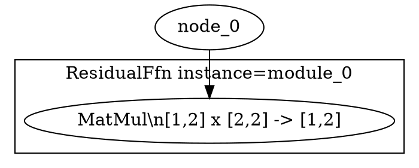

# VeriNeural
## Техническая спецификация архитектурно-независимого конструктора нейросетевых вычислений

**Тип проекта:** импортируемая Rust-библиотека, компилятор для NVIDIA GPU, минимальный CUDA runtime для запуска вычислений и система формальной верификации Lean 4.

**Назначение:** создание собственных нейросетевых архитектур, в том числе альтернативных Transformer для языкового моделирования, из математических операций, пользовательских алгоритмов и композиционных контрактов. VeriNeural предоставляет гибкий конструктор, а не готовую LLM или её инфраструктуру.

**Статус документа:** целевая спецификация без этапов/MVP. Реализованное подмножество и порядок разработки описаны в ROADMAP.md. Целевые требования ниже не означают, что всё уже реализовано.

### Границы продукта

- **Предмет разработки:** расширяемые вычислительные примитивы, Rust-контракты, вложенные блоки, параметризованные графы, Semantic Neural IR, компиляция в NVIDIA GPU, Lean-модели и композиционная проверка.
- **Уровни сборки:** операция → пользовательский блок → составной блок → полная архитектура. Модуль можно переиспользовать без копирования исходной математики на CUDA и Lean.
- **Не являются обязательными и не поставляются как готовая архитектура:** Transformer, стандартные Attention/MHA/GQA, KV Cache, специализированные MoE-роутеры, типовая LLM-инфраструктура, tokenizer, чат-сервис, serving API, распределённое обучение, оркестрация и деплой. Похожие функции автор вправе реализовать сам из универсальных примитивов.
- **Нужная исполняющая часть:** NVIDIA GPU compiler и минимальный runtime запуска/проверки GPU-кода. Отсутствие serving-инфраструктуры не означает отказ от CUDA Driver API.
- **Гарантии:** Lean доказывает только явно сформулированные свойства при их предпосылках. Корректность алгоритма не доказывает автоматически полезность, обучаемость, качество текста или производительность новой архитектуры.

## 1. Основные требования

Система должна обеспечивать:

1. Задание пользовательской математики и формальных контрактов на Rust в документированном поддерживаемом подмножестве.
2. Иерархическое построение параметризованных и переиспользуемых блоков, вложенных подграфов и произвольных поддерживаемых архитектур без LLM-шаблона.
3. Единый типизированный Semantic Neural IR, сохраняющий структуру композиции, зависимости, формы, параметры и контракты.
4. Генерацию из **одного IR** двух путей: LLVM NVPTX/PTX для NVIDIA GPU и Lean 4 моделей/теорем/обязательств доказательств.
5. Расширение вычислительного набора без ручного дублирования алгоритма на CUDA и Lean. Новый примитив должен иметь достаточную семантику и доказательства для запрашиваемого уровня гарантий.
6. Модульные доказательства и их композицию до уровня всей пользовательской архитектуры с собственными глобальными инвариантами.
7. Модели IEEE 754 binary32, точные численные доказательства или формально ограниченные погрешности при явных предпосылках.
8. Управление GPU-компиляцией: потоки, память, scheduling, fusion/tiling и FP32-политику с проверкой разрешённых преобразований.
9. Проверяемую привязку исходного IR, Lean-теорем, LLVM/PTX, параметров, профиля GPU и численно проверенных запусков к отчёту о TCB.
10. Отказ certified-build при неподдерживаемой операции, недоказанной обязательной цели или несовместимой композиции.

**Единый источник алгоритма и контракта — Rust-проект.** Это не обещание анализа произвольного Rust-кода: поддерживаемое подмножество и ограничения должны быть явными.

## 2. Общая архитектура

```text
                RUST SOURCE
          Modules + Math Contracts
                      │
                      ▼
               Rust Frontend
                      │
                      ▼
              Semantic Neural IR
                      │
           ┌──────────┴───────────┐
           │                      │
           ▼                      ▼
     GPU Compiler            Proof Compiler
           │                      │
     Fusion / Tiling         Lean 4 Models
     GPU Scheduling          Module Contracts
           │                 FP32 Semantics
           ▼                 Proof Obligations
         GPU IR                   │
           │                      ▼
           ▼                 Lean 4 Prover
        LLVM IR                   │
           │                      ▼
           ▼                 Proof Checker
       LLVM NVPTX                 │
           │                      │
           ▼                      │
          PTX                     │
           │                      │
           ▼                      │
    PTX Verification              │
           │                      │
           ▼                      │
     NVIDIA GPU                   │
           │                      │
           └──────────┬───────────┘
                      ▼
             Certificate Engine
                      │
                      ▼
     VERIFIED USER-DEFINED ARCHITECTURE
```

GPU Compiler и Proof Compiler используют один типизированный Semantic Neural IR с сохранёнными границами вложенных блоков, портами и доказательственными зависимостями.

Генерация LLVM IR и Lean 4 производится разными backend-компонентами, но пользовательские алгоритмы и контракты определяются только один раз. Lowering может разворачивать блоки для GPU, сохраняя проверяемое отображение на исходную иерархию.

## 3. Rust API и конструктор архитектур

Библиотека предоставляет архитектурно-независимый API для тензоров, вычислительных операций, параметров, явного состояния, контрактов и вложенной композиции.

Основные абстракции:

- `Tensor<T, Shape>` — тензор с проверенными размерами.
- `NeuralGraph` / `NodeId` — сборка вычислительного графа из поддерживаемых операций.
- `NeuralModule` — пользовательский или библиотечный блок с явным интерфейсом.
- `MathContract` — предусловия, постусловия и инварианты; при необходимости численные оценки.
- `FP32Policy` — требуемая численная семантика, не доказательство её соблюдения.
- **Целевое расширение конструктора:** параметризованные вложенные графы, иерархические области имён, повторно используемые блоки, экспортированные порты, состояния/переходы и пользовательские инварианты всей архитектуры.
- **Целевые типы результатов:** `Certified<T>` / `VerifiedKernel` только при наличии именно тех гарантий, которые они обещают. Ни численная проверка, ни успешная компиляция сами по себе не означают формальной сертификации GPU.

### 3.1. Пример пользовательской операции

Пример на действующем явном Rust DSL без шаблона Transformer:

```rust
use verineural::{NeuralError, NeuralGraph, NodeId};

fn custom_transition(
    graph: &mut NeuralGraph,
    state: NodeId,
    signal: NodeId,
    weights: NodeId,
) -> Result<NodeId, NeuralError> {
    let projected = graph.matmul(state, weights)?;
    let mixed = graph.add(projected, signal)?;
    graph.relu(mixed)
}
```

Реальные формы, домены и смысл `state` задаёт разработчик. Это **одно вычисление перехода**, а не уже реализованная рекуррентная машина или хранение долгосрочного состояния.

**Целевая иерархия:** такую функцию можно оформить модулем с `requires` / `ensures`, вложить много модулей в блок более высокого уровня и задать глобальный контракт архитектуры. Проверка крупного блока должна выводиться из проверенных свойств его частей, а не только из совпадения форм.

### 3.2. Пользовательская математика

- Поддерживаемые элементарные операции, включая линейную алгебру, редукции, индексацию и сравнения, образуют строительный материал, но не готовую LLM-архитектуру.
- Для новой операции явно задаются семантика, формы, домены, ограничения памяти, численная политика и обязательства доказательства. Разработчик не должен поддерживать три вручную синхронизируемые реализации алгоритма.
- Если расширение нельзя отобразить в поддерживаемые GPU IR и Lean-модель, оно получает статус `unsupported`. Это блокирует сертификацию, если соответствующая гарантия обязательна.
- Повторно используемые блоки должны иметь стабильную идентификацию и параметризацию для кеширования проверенных лемм и прослеживаемости отчёта.
- Динамические формы, ветвления, циклы, состояния и связи по времени имеют **явную семантику**. Подмножество без реализованной проверки не принимается под видом готовой сертифицированной функции.

## 4. Semantic Neural IR

Центральный компонент всей системы.

IR фиксирует арифметику, пользовательские блоки, иерархию композиций, контракты, параметры и их семантику. Из одного IR должны строиться и GPU-код, и Lean-модель.

### 4.1. Вычислительные средства

Целевой набор **универсальных**, расширяемых строительных операций:

- Поэлементная арифметика, линейная алгебра, преобразования форм и типов.
- Indexing, gather/scatter, slice и перестановки с проверяемыми условиями памяти.
- Редукции, агрегаты, сравнения, условные вычисления и маски.
- Пользовательские математические функции и нелинейные преобразования.
- Параметризованные подграфы, интерфейсы модулей и композиция функций.
- Явное состояние, многошаговые переходы и циклы для тех фрагментов, у которых определены семантика и правила проверки.
- При необходимости исследования: дифференцирование и обновления параметров как общие вычислительные преобразования, а не обязательный `Backward` специальной LLM.

Attention, KV Cache и другие известные архитектурные компоненты **не входят в обязательный каталог примитивов**. Пользователь вправе выразить подобный алгоритм через базовые операции, если те поддерживаются.

### 4.2. Метаданные каждой операции

Каждый узел IR содержит:

- Входные и выходные типы.
- Размерности тензоров.
- Математическое определение операции.
- Домен допустимых значений.
- FP32-семантику.
- Правила округления.
- Допустимую численную погрешность.
- Предусловия и постусловия.
- Идентификаторы проверенных теорем и ещё не разрешённых обязательств доказательства.
- Зависимости от других узлов, идентификаторы блоков и отображение входных/выходных портов.
- Параметры, состояние и условия применимости инвариантов, если заданы.
- Семантические требования к памяти, параллелизму и допустимым GPU-преобразованиям.

### 4.3. Математические модели

Каждая поддерживаемая операция должна иметь три связанных представления:

**Ideal Semantics**

Математическая операция над идеальными числовыми объектами, например действительными числами.

**FP32 Semantics**

Та же операция с определёнными IEEE 754 binary32-округлениями, порядком вычислений и обработкой специальных значений.

**GPU Semantics**

Семантика конкретной реализации GPU, включая FMA, редукции, память и выбранную последовательность инструкций.

Компилятор обязан явно проверять установленное соответствие между уровнями. При отсутствии формальной связи отчёт различает Lean-доказательство идеальной модели, численную проверку FP32-выхода и доверенную компиляцию; автоматически объявлять эти представления эквивалентными запрещено.

### 4.4. Канонический граф архитектуры в Graphviz DOT

VeriNeural обязан уметь строить из Semantic Neural IR **единый самодостаточный текстовый файл `architecture.dot`** в синтаксисе Graphviz DOT. Его назначение — дать человеку и ИИ-агенту полную картину собранной пользовательской нейросети в одном артефакте: какие экземпляры компонентов существуют, как они вложены, какие тензоры и параметры проходят между ними, какие размеры и контракты действуют на каждой границе, какие доказательства и GPU-преобразования относятся к конкретным узлам.

DOT является **проекцией единого Semantic Neural IR**, а не вторым источником истины. Архитектуру нельзя считать корректной только потому, что DOT успешно сгенерирован или визуализирован. Канонический файл обязан содержать fingerprint исходного IR и включаться в общий SHA-256 manifest, чтобы его можно было однозначно связать с доказательствами, LLVM/PTX и сертификатом.

#### Полнота и иерархия

Certified-экспорт должен описывать **весь построенный граф архитектуры**, а не только удобный или оптимизированный output slice:

- Все зарегистрированные входы, параметры, состояния, операции, составные блоки и архитектурные выходы.
- Все `ModuleInvocation` как отдельные **экземпляры** с устойчивым instance-id и полным instance path; повторное использование одного определения модуля должно быть видно как несколько разных экземпляров.
- Иерархию модулей через вложенные `subgraph cluster_*`; кластер не имеет права скрывать внутренние узлы. Иерархия нужна для читаемости, но все примитивные операции и связи остаются в том же `.dot`.
- Узлы, не достижимые от выбранных архитектурных outputs, если они присутствуют в Semantic Neural IR, не отбрасываются молча: они включаются и явно помечаются, например `vn_reachable_from_output="false"`.
- Явные state/control dependencies, циклические/переходные зависимости и ветви, если такие конструкции поддерживаются соответствующим IR-фрагментом.
- Никаких скрытых captured dependencies: связь, влияющая на вычисление или контракт модуля, должна быть видна как порт/ребро либо экспорт должен завершиться ошибкой.

#### Свойства узла

Каждый узел должен иметь стабильный `vn_id` и достаточно данных, чтобы по одному DOT-файлу восстановить его роль в архитектуре. Для применимых свойств требуется указывать как минимум:

- Тип сущности: architecture input, parameter, state, primitive operation, module boundary, architecture output или иной поддерживаемый вид.
- Имя/тип операции, definition-id и instance path составного блока.
- Идентификаторы входных/выходных портов и их порядок.
- Shape каждого входа и выхода, dtype, layout/индексацию и broadcast/reshape-семантику, если они существенны.
- Домен значений и математическое определение/краткую semantic signature операции.
- FP32 policy: rounding mode, FMA/contract policy, subnormal/FTZ policy, reduction order и обработку special values в той мере, в какой они заданы IR.
- Численный контракт: scale/диапазоны, `epsilon`, exactness либо иной поддерживаемый error contract.
- Предусловия, постусловия, инварианты и ссылки на относящиеся theorem/obligation identifiers.
- Статус гарантии для релевантных свойств: `proven`, `validated`, `trusted`, `unsupported`; неизвестное или неподдержанное свойство должно быть помечено явно, а не просто исчезать.
- Роль параметра/состояния, mutability/versioning и ограничения параметров, если это часть модели.
- GPU lowering metadata: выбранный kernel/lowering kind, fusion membership, launch/scheduling metadata, memory contract и другие свойства, которые реально зафиксированы в Semantic Neural IR или compilation evidence.
- Идентификаторы связанных артефактов/теорем, когда они нужны для перехода от архитектурной схемы к доказательству или lowering evidence.

Для читаемости разрешено использовать краткий `label` или HTML-table label, однако **полные данные не должны существовать только в визуальном label**. Канонические свойства следует дублировать структурированными DOT attributes с устойчивым префиксом `vn_*`, чтобы ИИ-агент или иной инструмент мог разбирать файл без рендеринга Graphviz.

#### Свойства рёбер

Каждое ребро должно явно описывать не только факт зависимости, но и её интерфейс:

- `vn_src_port` и `vn_dst_port`.
- Роль связи: `data`, `parameter`, `state`, `control` либо другой документированный вид.
- Shape/dtype передаваемого значения.
- Существенную трансформацию на границе: reshape/view, broadcast, indexing mapping, aliasing или state transition.
- Порядок/версию зависимости там, где от этого зависит семантика.
- Связанные numerical/memory constraints, если они относятся именно к этой границе.

Входы и выходы составного модуля должны быть визуально и структурно сопоставимы с его declared interface: по DOT должно быть возможно определить, какой внешний tensor подключён к какому порту каждого instance.

#### Метаданные всего графа

Корневой `digraph` должен содержать как минимум:

- Architecture id/version и версию формата DOT-экспорта.
- Версию/совместимость спецификации VeriNeural.
- Cryptographic fingerprint канонического Semantic Neural IR.
- Версию VeriNeural/toolchain metadata, если она входит в сертифицируемую сборку.
- Активный FP32/GPU profile.
- Идентификаторы глобальных proof obligations и итоговый assurance status, если они уже вычислены.
- Список/идентификаторы архитектурных входов и outputs.

Непроизводительные значения вроде текущего timestamp, случайных UUID или process-local адресов не должны попадать в канонический DOT, если из-за них одинаковый IR перестаёт давать одинаковый файл.

#### Детерминизм и пригодность для ИИ-анализа

Для одинакового Semantic Neural IR, одинаковой конфигурации экспорта и одинаковых proof/lowering metadata генератор обязан создавать **байтово детерминированный** `architecture.dot`:

- стабильные идентификаторы, instance paths и порядок атрибутов;
- стабильный порядок кластеров, узлов и рёбер;
- однозначное escaping строк;
- отсутствие зависимости от порядка hash-map, адресов памяти или process-global counters;
- явные значения `unknown`/`unsupported` вместо неоднозначного отсутствия критически важного свойства.

Файл должен оставаться удобным для чтения в сыром виде. Визуальные цвета, формы и стили разрешены как дополнительный слой, но семантика не должна кодироваться только цветом или геометрией.

Минимальный стиль канонического вывода может выглядеть так:



Это только пример формы сериализации. Реальный экспорт обязан отражать фактический Semantic Neural IR, а не жёстко заданный каталог архитектурных компонентов.

Рендеры `SVG/PNG/PDF` могут создаваться дополнительно, но не являются каноническим представлением и не требуются для разбора архитектуры. Генерация самого `.dot` не должна зависеть от наличия установленного Graphviz: VeriNeural обязан уметь сериализовать DOT самостоятельно.

## 5. Формальные контракты архитектурных компонентов

Каждый нейросетевой модуль определяется как функция с математическими предусловиями и постусловиями.

Контракт описывает:

- Допустимые входные значения.
- Размерности входов и выходов.
- Ограничения на параметры.
- Математические свойства результата.
- Инварианты модуля.
- Численные границы FP32-погрешностей.
- Условия взаимодействия с последующими модулями.

### 5.1. Composition Verification

При объединении модулей компилятор автоматически проверяет, что выходные гарантии одного модуля удовлетворяют входным требованиям следующего.

Формальная цель композиции:

```text
Module A:
    requires P
    ensures  Q

Module B:
    requires Q
    ensures  R

Composition B(A(x)):
    requires P
    ensures  R
```

Для численных модулей свойство `Q` включает не только математические условия, но и допустимые FP32-погрешности.

Если предыдущий блок гарантирует погрешность `ε₁`, а следующий допускает максимум `ε₂`, компилятор обязан доказать совместимость этих условий.

Если требуемое свойство не следует из доступных контрактов и лемм, композиция не сертифицируется.

### 5.2. Инварианты произвольных архитектур

Конструктор должен поддерживать проверяемые свойства **без предположения о типе архитектуры**:

- Размерности, совместимость портов, диапазоны индексов, корректность адресации и объёма памяти.
- Предусловия пользовательских операторов, гарантии их результатов и корректность их повторного использования в блоках.
- Границы значений, монотонность, знаковые и алгебраические инварианты, ограничения состояний.
- Композицию вложенных вычислительных графов и передачу гарантий между блоками.
- Для повторяющихся вычислений: инвариант начального состояния, корректность одного перехода и индуктивное сохранение инварианта для всех разрешённых шагов.
- Для ветвлений или дискретных решений: условия стабильности выбора, корректность условий и согласованность путей.
- Для полной архитектуры: **пользовательские глобальные свойства**, формально сформулированные относительно её входов, выходов, параметров, состояния и конфигурации.

Ни наличие `NeuralModule`, ни успешная проверка форм не равнозначны доказательству функциональной корректности. Система должна явно перечислять доказанные цели, гипотезы и неподдерживаемые требования.

### 5.3. Иерархическая композиция и повторное использование доказательств

1. Пользователь описывает элементарный оператор с математической семантикой и контрактом.
2. Собирает **локальный блок** из операторов, формулирует инварианты и экспортируемый интерфейс.
3. Собирает **крупный блок** из экземпляров локальных блоков с конкретными параметрами и связями.
4. Собирает **полную пользовательскую архитектуру** и формулирует итоговые свойства.
5. Lean проверяет локальные свойства, условия применимости и теоремы композиции. Доказательства экземпляров можно переиспользовать лишь при подтверждённых предпосылках и совпадении семантики/параметров.

Иерархия сохраняется для proof/debug/reporting даже при разворачивании или fusion GPU-графа. Композиционный сертификат должен связывать теоремы об отдельных блоках с теоремой об архитектуре, а не представлять список локальных доказательств как доказательство всей системы.

## 6. FP32 Verification Engine

**FP32-верификация является обязательной частью архитектурной верификации, а не самостоятельной необязательной проверкой.**

### 6.1. Формальная арифметика

Lean 4 должен иметь формальную модель IEEE 754 binary32, используемую для доказательства свойств поддерживаемых операций.

Модель обязана учитывать:

- Округление Round-to-Nearest, Ties-to-Even и другие разрешённые режимы.
- FMA и отдельные Multiply/Add.
- Subnormal Values и Flush-to-Zero.
- NaN и Infinity.
- Signed Zero.
- Порядок выполнения операций.
- Ошибки накопления при редукциях.
- Погрешности математических функций, включая `exp`, `sqrt`, `tanh` и функции активации.

### 6.2. Два класса численных гарантий

**Exact FP32**

Доказательство соответствия битовой FP32-модели, включая определённые правила округления и специальные значения.

**Bounded Numerical Error**

Доказательство ограниченной погрешности относительно идеальной математической модели:

```text
For all x in ValidDomain:

    error(FP32(x), Ideal(x)) <= epsilon
```

Для сравнения с действительными числами должны быть определены условия конечности значений и корректная метрика ошибки. Неопределённые случаи, NaN и Infinity обрабатываются отдельными контрактами.

Система может использовать доказанную интервальную арифметику, оценку ошибок округления и специальные леммы для нелинейных функций.

### 6.3. Распространение погрешностей

Численная погрешность распространяется через **произвольно определённый граф** и его вложенные блоки. Иллюстрация без привязки к Transformer:

```text
Input + Parameters
       │
       ▼
Custom Block A     error ≤ ε₁
       │
       ▼
Custom Block B     error ≤ ε₂
       │
       ├──────────────┐
       ▼              ▼
Custom Branch C   State Transition D
       └──────┬───────┘
              ▼
        Architecture Output
        proven bound ε_total
```

Итоговая оценка определяется свойствами конкретных операций (чувствительностью к входным ошибкам, формой композиции, параметрами, нелинейностями). Она не обязана равняться простой сумме ε.

Для пользовательских ветвлений, маршрутизации и сравнений малое численное отклонение может изменить выбор пути. Для доказательства эквивалентности дискретного решения требуется достаточный зазор между сравниваемыми значениями, проверка граничных условий или явная процедура точного разрешения неоднозначности.

## 7. GPU Compiler

GPU Compiler переводит **любую поддерживаемую пользовательскую композицию** Semantic Neural IR в низкоуровневое GPU IR, затем в LLVM IR и PTX. Он не должен зависеть от фиксированного набора LLM-слоёв.

Обязательные функции:

- Operator Fusion.
- Kernel Fusion.
- Matrix Tiling.
- Thread Scheduling.
- Warp-Level Operations.
- Shared Memory Management.
- Memory Coalescing.
- Reduction Scheduling.
- **CUDA Graph execution:** построение графа GPU-работы из Semantic Neural IR, выделение допустимых зависимостей, инстанцирование и запуск через CUDA Graph API, а не последовательные независимые kernel launches.
- **Kernel Fusion:** контролируемое объединение совместимых вычислений с учётом повторных потребителей и семантических ограничений.
- **No CUDA Legacy Streams:** запрещены legacy/default/null streams, их неявная синхронизация и обход CUDA Graph через прямой запуск kernels; только явно выделенный non-blocking CUDA stream для graph capture/launch и передач данных.
- GPU Kernel Launch (внутри CUDA Graph).
- Явно управляемый профиль генерации: layout, размерность сетки, распределение работы, допустимые преобразования, варианты kernel и выбор ресурсов в рамках проверяемого подмножества.
- Memory Safety Verification.
- Race Freedom Verification.
- Synchronization Verification.

Цель — высокий контроль и эффективность на NVIDIA GPU без жёстко заданных алгоритмических шаблонов. Предусмотрены инспекция LLVM IR/PTX, возможность выбора/ограничения оптимизаций и сообщения о фактически применённых преобразованиях. Эффективность должна оцениваться измерениями, а не предполагаться из названия backend'а.

Оптимизации не могут свободно изменять FP32-семантику.

Каждое преобразование должно иметь проверенное правило корректности, учитывающее точность арифметики.

Если Fusion заменяет отдельные `mul` и `add` на FMA, система обязана учитывать изменение округления и доказать соответствие численному контракту.

### 7.0. Правила CUDA Graph и stream policy

1. CUDA вычислительный граф строится из достижимых узлов Semantic Neural IR. Зависимости между nodes должны сохранять результаты оригинального графа после допустимых слияний и иных преобразований.
2. `CU_STREAM_LEGACY`, `stream = 0` и любые эквивалентные default/null-stream пути **запрещены**. Для capture, `cuGraphLaunch`, host↔device transfers и ожидания используется явно созданный `CU_STREAM_NON_BLOCKING`, без неявного legacy fallback.
3. Внутри обычного пути инференса нельзя исполнять отдельные kernels вне CUDA Graph. Прямой `cuLaunchKernel` допускается **только во время stream capture**, где он формирует kernel-node графа; альтернативой является `cuGraphAddKernelNode`.
4. Память и потоковые зависимости должны иметь корректную область жизни для всего CUDA Graph. Буферы передачи с асинхронной операцией не освобождаются до её завершения; CPU/GPU конкуренция за данные запрещена.
5. Fusion — центральная стратегия сокращения числа GPU kernels и промежуточных аллокаций, а не обход математических проверок. Недоказанная FP32-эквивалентность не становится `proven` благодаря использованию CUDA Graph.
6. Если CUDA Graph API не поддерживается, соответствующий запуск отклоняется; совместимого обхода через legacy streams не существует.
7. Производительность проверяется на устройстве, отдельно различаются накладные расходы инстанцирования графа, replay и фактическое kernel execution.

### 7.1. Проверка результатов lowering

Система должна проверять соответствие:

```text
Semantic Neural IR
        ↕
    Verified GPU IR
        ↕
      LLVM IR
        ↕
        PTX
```

Для этого необходимы формальные семантики поддерживаемого подмножества инструкций, механизмы translation validation и доказательства сохранения наблюдаемого поведения.

Операции вне проверяемого подмножества отклоняются в сертифицированной сборке.

### 7.2. Граница доверия

Формальная проверка PTX не является автоматическим доказательством поведения произвольного физического GPU.

Если корректность последующей компиляции PTX в машинный код и исполнения аппаратурой не доказана, драйвер, JIT, устройство и соответствующие правила исполнения должны быть указаны как доверенные предположения.

Система не имеет права представлять условную гарантию как безусловное доказательство корректности аппаратного исполнения.

## 8. Lean 4 Proof Engine

Proof Engine генерирует формальные модели и доказательства по структуре Semantic Neural IR.

### Типы доказательств

**Module Correctness**

Соответствие реализации математической спецификации.

**Composition Correctness**

Корректность взаимодействия отдельных архитектурных блоков.

**Numerical Correctness**

FP32-эквивалентность или математически доказанные границы погрешности.

**Optimization Correctness**

Корректность Fusion, Tiling и остальных преобразований компилятора.

**Memory Correctness**

Отсутствие недопустимых обращений к памяти, гонок и нарушений заданной модели синхронизации.

**Network Correctness**

Корректность композиции всех компонентов нейросети при заданных предусловиях.

### Механизм доказательств

Предусматривается библиотека проверенных лемм для тензоров, численной арифметики, маршрутизации и композиции.

Proof Engine автоматически создаёт задачи доказательства, применяет подходящие леммы и тактики и передаёт результаты проверяющему ядру Lean.

Новая пользовательская математика может создавать дополнительные обязательства доказательства. Если автоматическая система их не разрешает, разработчик должен уточнить контракт или предоставить вспомогательные леммы в Rust-ориентированном интерфейсе спецификаций.

Ручное создание отдельной реализации алгоритма на Lean не требуется.

Использование `sorry`, непроверенных аксиом или непрозрачных доверенных вычислений без соответствующего разрешения политикой сертификации запрещается.

## 9. Верификация целой пользовательской архитектуры

Итоговый объект VeriNeural — **произвольная архитектура, собранная разработчиком** из универсальных примитивов и вложенных блоков. Языковая модель, если она создаётся поверх библиотеки, является *потребителем*, а не встроенной реализацией Transformer или сервиса инференса.

Цели проверки полной архитектуры:

- Типовая и размерностная корректность всех соединений, параметров и состояний.
- Корректность контрактов отдельных операций и их включение в контракт каждого составного блока.
- Выполнение предпосылок повторно используемых лемм и доказательств.
- Глобальные функциональные свойства архитектуры, если они заданы разработчиком: отношения входов и выходов, ограничения состояния, инварианты переходов и условий ветвления.
- Численные гарантии композиции, включая FP32-поведение и распространение ошибки в пределах объявленных доменов.
- Применимость доказательств к реально использованным параметрам, GPU-профилю, оптимизациям и конкретным запускам.

**Что именно доказывает Lean:** каждое проверенное утверждение относится к указанной модели и предпосылкам. Поузловое равенство определению в Lean или проверки интерфейсов недостаточно, чтобы автоматически заключить корректность всей архитектуры. Для глобального `proven` требуется отдельная проверенная теорема композиции об этом глобальном свойстве.

Если исследователь включает обучение, изменение параметров или пользовательское состояние, их семантика и контракты проверяются аналогично прочим вычислениям. Готовый generic Backward/optimizer **не обязателен** для завершённости самого конструктора: необходим путь для определения и проверки пользовательских обновлений в поддерживаемом подмножестве.

**Не следует из доказательств:** качество генерации, соответствие задаче, интеллект системы, способность к обобщению, сходимость оптимизации и достаточная производительность. Для этих заявлений нужны отдельные спецификации, измерения и доказательства.

## 10. Сертификация параметров и исполнения

Для итоговой нейросети сертификат должен учитывать:

- Версию архитектуры.
- Конфигурацию модулей.
- Значения или проверенные ограничения параметров.
- Размерности и динамические диапазоны форм.
- FP32-профиль.
- GPU-архитектуру.
- Версии используемых инструментов.
- Формальные предположения.

При загрузке весов система проверяет соответствие параметров условиям применимости доказательств.

Если доказательство опирается на конкретные веса, их изменение требует новой сертификации. Если доказательство универсально по всем весам, удовлетворяющим контракту, достаточно проверить этот контракт.

Для отдельного запуска система должна различать:

- Универсальную теорему о вычислениях.
- Проверку принадлежности конкретного входа допустимому домену.
- Сертификацию конкретного результата.

При необходимости допускается повторная проверка результата или специализированный проверяемый вычислительный сертификат.

## 11. Логические компоненты и организация проекта

Целевые **ответственности**, а не предписание создать отдельный crate на каждое название:

- **Rust API / Frontend:** создание пользовательских операций, параметризованных блоков и контрактов.
- **Typed Semantic Neural IR:** типы, формы, семантика, зависимости, интерфейсы и иерархия модулей, явное состояние.
- **Proof Backend:** Lean-модели, задачи доказательства, проверенные леммы и композиционные теоремы.
- **GPU Backend:** контролируемые layout/scheduling/оптимизации, LLVM NVPTX/PTX, проверки lowering.
- **CUDA Runtime:** минимальный запуск и проверка вычислений на NVIDIA GPU, без serving/деплоя/серверов.
- **Certificate Engine:** связность артефактов, доказательные зависимости, границы TCB и статусы гарантий.
- **Примеры и тесты:** пользовательские математические операторы, вложенные композиции, состояние и архитектурно-нейтральные графы, а не готовая LLM.

Реальная Rust-библиотека размещается в `crates/verineural/` внутри Cargo workspace; отдельные crates создаются лишь по фактической необходимости и правилам `AGENTS.md`. Целевая разбивка Lean-файлов определяется реализованными математическими и компиляционными доказательствами.

## 12. Сборка пользовательской архитектуры

**Целевой**, ещё не реализованный полностью интерфейс:

```bash
cargo verineural build --certified
```

Обязательный процесс:

1. Принять из Rust конструктора пользовательские операторы, составные модули, параметры и глобальные свойства.
2. Построить единый Semantic Neural IR с иерархией блоков и идентичностью их экземпляров.
3. Проверить формы, домены, состояние и совместимость локальных контрактов.
4. Сгенерировать Ideal/FP32/GPU-семантики в поддерживаемом подмножестве.
5. Сгенерировать и проверить Lean-доказательства для примитивов, блоков, связей и **глобальных требований архитектуры**.
6. Применить разрешённые контролируемые GPU-преобразования и получить LLVM IR/PTX.
7. Проверить необходимые инварианты памяти, GPU-lowering и численную семантику, если они входят в запрошенный уровень.
8. Проверить актуальность параметров, GPU-профиля и предпосылок входных доменов.
9. Из финального аннотированного Semantic Neural IR и связанных proof/lowering metadata детерминированно выпустить полный `architecture.dot`; его `vn_ir_sha256` должен соответствовать каноническому IR этой же сборки.
10. Выпустить исполняемые файлы и отчёт с уровнями `proven`, `validated`, `trusted`, `unsupported`.

Любое недоказанное **обязательное** свойство останавливает сертифицированную сборку. Отдельный диагностический запуск допустим, но не объявляется формальным сертификатом.

## 13. Выходные артефакты

**Пример целевой схемы** для произвольной пользовательской архитектуры:

```text
target/verineural/<architecture-id>/
├── semantic.ir
├── architecture.dot
├── gpu/
│   ├── program.ll
│   └── program.ptx
├── verification/
│   ├── primitives.lean
│   ├── blocks.lean
│   ├── architecture.lean
│   ├── numerical.lean
│   └── lowering.lean
├── certificates/
│   └── architecture.json
├── reports/
│   ├── obligations.json
│   ├── numerical.json
│   └── trusted_base.json
└── SHA256SUMS
```

Это целевая организация, **не утверждение**, что все файлы уже создаются. Файл доказательства или статус `proven` может появляться только при реальной проверке соответствующей цели.

Отчёт должен связывать: исходный IR, `architecture.dot`, пользовательские операции и вложенные блоки, теоремы и гипотезы, входы, значения параметров либо их ограничения, численную политику, профиль NVIDIA GPU, версии инструментов, LLVM/PTX, результаты исполнения, TCB и хеши артефактов.

`architecture.dot` является обязательным человеко- и машиночитаемым индексом архитектуры, но не заменяет `semantic.ir`, Lean evidence или сертификат. Certified build должен проверять, что указанный в DOT fingerprint IR совпадает с каноническим IR текущего bundle. Опциональные визуальные рендеры из DOT не являются источником доказательства и могут не входить в манифест.

SHA-256 обеспечивает контроль целостности относительно доверенного манифеста, а не авторство. JSON или DOT не подменяют Lean-доказательство и не подтверждают корректность машинного кода сами по себе.

## 14. Обязательные условия приёмки

VeriNeural считается **готовым архитектурно-нейтральным конструктором**, когда выполнено каждое условие:

1. Пользователь на Rust задаёт **собственную математическую операцию** и строит из неё несколько параметризованных, повторно используемых блоков без предписанной архитектуры LLM.
2. Блоки вкладываются друг в друга и образуют крупную пользовательскую архитектуру с явными портами, параметрами, при необходимости состоянием и глобальными контрактами.
3. Из **одного Semantic Neural IR** автоматически генерируются исполняемая NVIDIA GPU-программа и Lean 4-модели без ручного переписывания одной логики на CUDA/Lean.
4. Lean проверяет содержательные локальные математические свойства блоков, а не только формы и поузловые равенства собственным определениям.
5. Для заявленного глобального свойства архитектуры есть отдельная проверенная **композиционная теорема**, связывающая локальные леммы, интерфейсы, параметры, инварианты и предпосылки.
6. Для поддерживаемого FP32-фрагмента формально доказаны заявленные точные свойства либо ограниченная численная ошибка, распространяющаяся по композиции.
7. Поддерживаемые GPU-lowering и оптимизации имеют проверенные свидетельства сохранения нужной семантики. Оставшиеся границы доверия честно перечислены в TCB.
8. Параметры, домены входов, конфигурация архитектуры, профиль GPU, инструменты, IR/Lean/LLVM/PTX и доказательства привязаны проверяемыми артефактами.
9. Из того же Semantic Neural IR детерминированно генерируется один полный `architecture.dot`, содержащий иерархию модулей, все экземпляры и связи, формы/типы/порты, параметры/состояние, численные и proof/GPU metadata; он связан fingerprint'ом с каноническим IR и пригоден для анализа без внешних файлов.
10. Certified-build отклоняет неподдерживаемые операции и недоказанные обязательные свойства; численная валидация не выдаётся за доказательство.
11. End-to-end собственная архитектура собирается и исполняется на NVIDIA GPU с независимой проверкой результата **без обязательных Transformer, KV Cache или serving-инфраструктуры**.

**Не являются критериями завершения:** готовые Transformer/Attention/MoE/KV Cache, типовая LLM, inference API, чат-система, сервер/деплой, распределённый тренинг, доказанное качество или скорость генерации текста.

## 15. Основные архитектурные принципы

**Architecture Neutrality**

Конструктор не навязывает Transformer либо любую другую модель. Поддержка ограничивается явными вычислительными примитивами, состояниями, композициями и формально описанной семантикой.

**Hierarchical Composition**

Составные блоки имеют проверяемые интерфейсы, параметризацию и связи. Корректность всей архитектуры требует доказательства отдельного глобального утверждения, а не простой агрегации локальных успехов.

**Single Source of Truth**

Алгоритмы, архитектурные компоненты и контракты определяются в едином Rust-проекте.

**Semantics First**

Промежуточное представление фиксирует математическую и численную семантику до GPU-оптимизаций.

**Proof-Carrying Compilation**

Оптимизации сопровождаются проверяемыми свидетельствами сохранения заданных свойств.

**Numerical-Aware Composition**

Архитектурные теоремы учитывают реальную численную точность и ограничения операций.

**Fail-Closed Certification**

Если обязательное доказательство отсутствует, итоговый сертификат не создаётся.

**Explicit Trust Boundary**

Система не скрывает непроверенные предположения о компиляторе, драйвере или GPU.

**Reusable Proofs**

Один раз доказанные математические примитивы и правила композиции повторно используются для новых архитектур.

**Inspectable Architecture**

Полная собранная архитектура должна иметь детерминированное самодостаточное DOT-представление, в котором явно видны hierarchy, instance identity, shapes, ports, зависимости, контракты и статусы доказательств/lowering. Визуальная схема является проверяемо связанной проекцией Semantic Neural IR, а не параллельной моделью.

---

## 16. Конечная цель

**VeriNeural — конструктор проверяемых вычислительных архитектур для NVIDIA GPU.** Его назначение — дать исследователю инструменты для реализации собственных алгоритмов, включая альтернативные Transformer способы построения языковых моделей, без поставки предзаданной LLM.

Разработчик на Rust:

1. Определяет математические операции и их ограничения.
2. Объединяет операции в повторно используемые малые и крупные блоки.
3. Строит из блоков архитектуру со своей логикой передачи данных, параметрами и, если требуется, состоянием.
4. Формулирует локальные контракты и отдельные глобальные утверждения об архитектуре.

VeriNeural для **поддерживаемой** семантики:

1. Создаёт единый типизированный Semantic Neural IR.
2. Генерирует из него детерминированный полный `architecture.dot`, пригодный для чтения человеком и ИИ-агентом и связанный fingerprint'ом с IR.
3. Компилирует управляемый NVIDIA GPU-код через LLVM NVPTX → PTX.
4. Генерирует Lean 4-модели и проверяемые теоремы о примитивах и блоках.
5. Проверяет условия композиции и заявленные глобальные свойства архитектуры.
6. Доказывает доступные численные гарантии FP32 и условия применимости.
7. Проверяет допустимые оптимизации и связи между IR/LLVM/PTX в покрытом доказательствами подмножестве.
8. Выпускает проверяемый отчёт со статусами, предпосылками и TCB, **не называя неподтверждённое доказанным**.

**Результат:** одна точка разработки математической логики на Rust, масштабируемая модульная композиция и две согласованные целевые ветви компиляции, NVIDIA GPU и Lean 4. Система подтверждает определённые свойства вычислений и архитектуры, но не обещает автоматически доказать работоспособность любой новой математики, интеллект модели или безусловную корректность железа.
